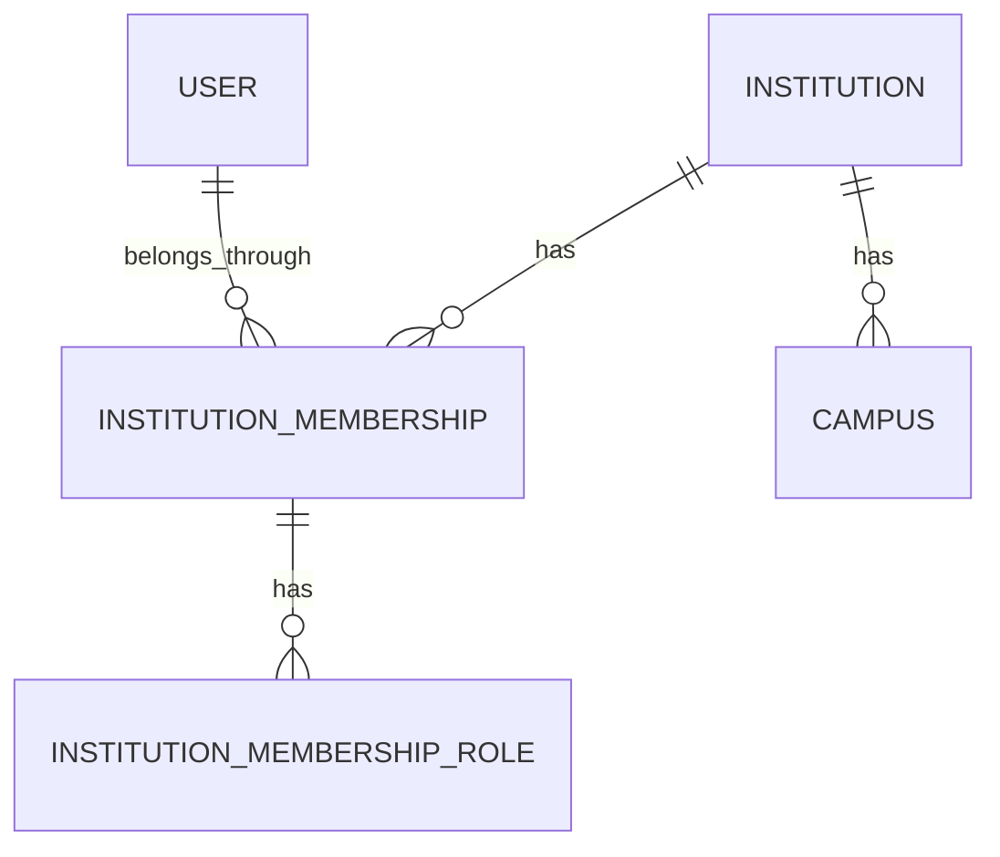
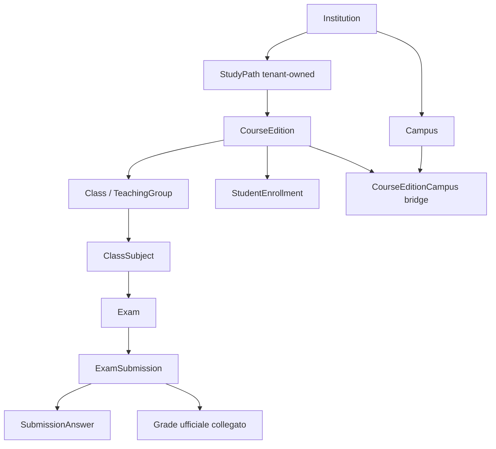

# ElectronicRegister - stato corrente MT-3B

**Checkpoint B completato nel livello Application/Infrastructure Student, Teacher e Subject. MT-3 complessiva PARZIALE: C/D/E restano da implementare. Nessuna API scolastica multi-tenant operativa; gate legacy chiuso.**

Questa sezione aggiorna gli snapshot storici conservati sotto. Verifiche, file, rischi ed evidenze: [MULTITENANCY_MT3B_REPORT.md](../../tests/Integration/MULTITENANCY_MT3B_REPORT.md). Baseline 387 test preservati; due suite definitive 426/426, zero Failed/Skipped, 39 nuovi casi MySQL scoped.

## Application e repository istituzionali

Nuove interfacce dedicate IInstitutionStudentManager, IInstitutionTeacherManager e IInstitutionSubjectManager utilizzano esclusivamente i rispettivi repository istituzionali. Vecchi manager/repository e controller conservano i percorsi legacy. I nuovi manager ricavano TenantContext dall'ICurrentTenant scoped MT2 e rivalidano membership, Institution Active e insieme dei ruoli tramite IInstitutionAuthManager a ogni operazione. InstitutionSchoolAuthorization centralizza la policy; nessun ruolo o profilo deriva dai campi legacy User. Assenza del contesto fallisce senza fallback, anche negli host non HTTP.

InstitutionAdmin amministra solo il proprio istituto. Teacher risolve il profilo nella membership corrente e vede studenti delle classi assegnate e materie pertinenti. Student risolve il proprio profilo, non ottiene la directory studenti e vede solo materie delle assegnazioni della propria classe. Directory nomi/ID Teacher ammessa ai ruoli preesistenti entro il tenant; Count resta Admin/Teacher. I ruoli multipli non sono ridotti a un UserRole; la richiesta del proprio profilo richiede sempre ruolo e collegamento pertinenti.

## Query, scritture e integrita

InstitutionSchoolQueries applica EF.Property<Guid>(entity, "InstitutionId") prima della materializzazione. ClassSubject, Class, Teacher, Subject e Student sono coerenti per tenant; visibilita tramite EXISTS SQL, Count lato server, AsNoTracking e numero costante di query. Subject/byTeacher interseca la stessa assegnazione visibile nella classe Student, anche se la materia esiste in piu classi. Nessun filtro globale seguito da filtro in memoria.

I writer valorizzano esplicitamente la shadow property InstitutionId prima del salvataggio. Update/Delete includono owner e ID nel predicato SQL; owner non trasferibile. La creazione puo collegare solo membership esistenti Active con ruolo pertinente nello stesso istituto; non crea User, membership o ruoli. TransactionManager rende atomico il link. Delete Student conserva il divieto in presenza di Grade con lock sul solo parent Student nella transazione, senza modificare i lock Exam/Submission. Le 27 FK composite e i 40 trigger MT3A restano invariati, nessun DDL o nuova configurazione EF duplicata.

## Holding e limiti operativi

La holding `4d543341-0000-4000-8000-000000000001` / `MT3A_LEGACY_TEST` resta provisioning. Il manifest SQL legacy non equivale al manifest auth `LEGACY_MT1`: nessuna attivazione, copia o trasferimento. I test usano due istituti Active temporanei espliciti e scope distinti con teardown; il database persistente torna alla sola holding. Nessuna modifica di produzione.

L'autorizzazione corrente e verificata prima dell'operazione; una revoca non annulla retroattivamente operazioni gia in corso. I repository istituzionali richiedono il contesto verificato dal manager. Exam, Submission, Grade, Audit e worker non sono migrati. Le cinque API MT2 e il rifiuto dei token scoped sulle route scolastiche legacy restano verificati; l'isolamento HTTP positivo richiede MT-3C.

---

## Snapshot storico MT-3A e fasi precedenti


# ElectronicRegister — stato corrente MT-3A

**Checkpoint A completato sul solo test DB; MT-3 complessiva PARZIALE. B/C/D/E non completati. Nessun secondo tenant operativo, gate legacy chiuso.**

Questa sezione aggiorna lo stato dello schema; le sezioni MT1/MT2/MT3 parziale conservate sotto sono snapshot storici. Report verificato: [MULTITENANCY_MT3A_REPORT.md](../../tests/Integration/MULTITENANCY_MT3A_REPORT.md). Inventario completo con PK/FK/UNIQUE e analisi per indice: [MULTITENANCY_MT3A_OWNERSHIP_INVENTORY.md](MULTITENANCY_MT3A_OWNERSHIP_INVENTORY.md).

## Ownership effettiva

User rimane identita globale; Institution identifica la Fondazione ITS Academy. Membership collega l'identita alla fondazione e i ruoli appartengono alla membership. Student e Teacher sono profili scolastici specifici dell'istituto, con InstitutionId diretto anche quando non esiste User. I due collegamenti istituzionali gia presenti restano opzionali e univoci per profilo; non vengono duplicati o sostituiti da membership inventate.

Le 19 tabelle scolastiche hanno ora InstitutionId NOT NULL/FK Institution RESTRICT e ownership immutabile. Anche le dipendenze/ponte materializzano il tenant per chiudere gli archi con FK composite; il ponte ruoli MT1 rimane indirettamente owned dal singolo parent Membership. Institution e il registro del tenant; non e una risorsa scolastica con un tenant superiore. Le categorie complete A/B/C/D/E sono nell'inventario.

Subject/StudyArea/StudyPath sono cataloghi modificabili per fondazione: UNIQUE(institution_id,name). Biennium conserva il significato legacy, con UNIQUE(institution_id,start_year,end_year). Nomi/date uguali A/B sono validi, senza condividere record. Class e ponti conservano le unicita funzionali originali. Nessuna CourseEdition o nuova semantica dei bienni.

## Integrita SQL e cancellazioni

27 FK composite aggiuntive impediscono archi cross-tenant lungo l'intera gerarchia, profili, ClassSubject, Exam/Retake, assegnazioni, Submission/Grade, Question/Option/Answer e Violation. Owner e chiavi tecniche sono controllati da MySQL, non da Global Query Filters. Guid CHAR(36) ASCII/collation coerenti, SQL mode strict, nessun CHECK critico MySQL 5.7.

Le tre FK storiche SET NULL non possono usare direttamente InstitutionId obbligatorio: scope nullable class_institution_id/retake_institution_id/grade_institution_id vengono rese uguali all'owner dai trigger quando il puntatore esiste. Alla cancellazione si annullano scope e puntatore, conservando l'owner. Tutte le delete rule originali rimangono invariate, comprese CASCADE/RESTRICT; Institution e sempre RESTRICT verso la didattica. Le FK legacy restano per la compatibilita delle navigazioni; quelle composite sono solo enforcement SQL aggiuntivo, senza relazioni EF duplicate.

Answer materializza ExamId dalla Submission e ha FK triple verso Submission e Question dello stesso esame. Il ponte opzioni materializza QuestionId dall'Answer e ha FK triple verso Answer e Option della stessa domanda. Le chiavi tecniche vengono ricalcolate anche su UPDATE: NULL o valori arbitrari del writer non aggirano il vincolo.

## Audit e compatibilita dei writer

Audit InstitutionId e nullable soltanto per la forma esplicita platform: EntityType=platform, azione platform.*, EntityId/BeforeJson/AfterJson NULL. Gli eventi didattici effettivi exam/exam_submission ricevono l'owner dalla risorsa; ownership/EntityType/EntityId storici sono immutabili, anche dopo cancellazione della risorsa. Sconosciuti/orfani senza attribuzione verificabile fermano la migrazione; non diventano globali. Nessuna API o autorizzazione globale di lettura audit aggiunta.

I writer scolastici legacy non sono migrati. Le dipendenze ereditano l'owner dal parent; le sole radici senza owner/parent usano il manifest SQL mt3a_legacy_scope esplicitamente installato per il dataset legacy. DEFAULT Guid vuoto e solo sentinel sostituito dal trigger; nessuna riga scolastica puo conservarlo. Il manifest non usa HTTP/TenantContext e non conferisce diritti: il gate MT2 rimane identico. La holding tecnica autorizzata di test e provisioning, senza identita legale o membership inventate.

EF database-first: InstitutionId e shadow property nel nuovo sidecar; entity/context generati preservati. Quattro indici catalogo riconfigurati, join dictionary mantenuto, vincoli/colonne tecniche SQL-only. Scaffold completo candidato verificato; Apply parziali MT1/MT3 ora rifiutano prima di perdere hook/mapping successivi. Una futura rigenerazione completa richiede riconciliazione esplicita, senza copiare tutte le navigazioni composite duplicate prodotte dal candidato.

## Confini ancora applicativi

SQL garantisce coerenza del grafo, non autorizzazione alla lettura: ogni lookup/aggregato/raw SQL/export/lock dovra filtrare InstitutionId e verificare caller+membership+ruoli. Rimangono applicativi iscrizione/classe ammessa, ruolo docente/reviewer nel tenant, Grade ufficiale coerente con studente e materia dell'esame entro tenant, cardinalita Single/Multiple/Open, retake semantici/cicli, lifecycle, calcolo e lock. Nessuna modifica alle regole esami o ai manager/worker in questa fase.

User.Role/link globali, ClaimsContext, vecchie route, LegacyEndpointGate e bridge rimangono fino a C/D/E e cutover autorizzato. Le FK non autorizzano a rimuovere il gate. Nessun onboarding, CourseEdition, randomizzazione, migrazione worker o secondo tenant operativo.

---

## Snapshot precedenti conservati (le affermazioni di schema non ancora migrato descrivono lo stato precedente a MT-3A)


# ElectronicRegister - Multitenancy Design (MT-1 / MT-2)

## MT-3: checkpoint PARZIALE, accesso scolastico multi-tenant ancora chiuso

Questa consegna non completa MT-3: A e parziale, B e preparatorio, C/D/E non migrati.
Le descrizioni MT1/MT2 sotto restano lo storico. La matrice corrente e in
[MULTITENANCY_ISOLATION_MATRIX.md](MULTITENANCY_ISOLATION_MATRIX.md), con tabelle,
DbSet, metodi repository/manager, route, DTO Guid, raw SQL, background e flussi audit.

Implementati due collegamenti: institution_student_profile e institution_teacher_profile.
Ogni riga contiene InstitutionId, MembershipId e StudentId oppure TeacherId. PK composta
(InstitutionId,MembershipId), UNIQUE del profilo, FK composita verso la membership dello
stesso istituto e FK RESTRICT verso il profilo. Un profilo non viene riusato in due
fondazioni; una membership puo avere entrambi i collegamenti. Le credenziali restano
in un solo User globale. Nessuna colonna/relazione legacy eliminata o riscritta.

InstitutionProfileResolver verifica ruoli/stati correnti con l'autorizzatore MT2 e poi
risolve il profilo con UserId+InstitutionId+MembershipId. Nessun fallback a User.StudentId
o TeacherId; assenza profilo/ruolo o revoca fallisce controllatamente. Un amministratore
non implica un profilo docente. Servizio preparatorio, **non ancora consumato dai manager
didattici**. Nessun endpoint nuovo e nessuna policy scolastica aperta.

Questo collegamento NON attribuisce automaticamente il tenant a Class/Subject/Exam/
Grade e NON protegge le FK legacy Student.ClassId o ClassSubject.TeacherId. Le righe
Student/Teacher ancora prive di collegamento restano legacy non attribuite. Il futuro
ownership/backfill dell'intero grafo e necessario prima del cutover. Ruoli della
membership possono cambiare senza cancellare i collegamenti storici: la validazione
applicativa corrente, non la sola FK, autorizza l'utilizzo del profilo.

Scelta motivata: collegamenti laterali preservano il flusso database-first e i Guid e
non richiedono di modificare a mano User/Student/Teacher generati. Le entity nuove sono
scaffolded; mapping partial separato con relazioni unidirezionali ai tipi esistenti.
Nessun filtro globale permissivo, tenant implicito o principal worker globale aggiunto.
Rimane in vigore il gate MT2 che rifiuta tutti i token scoped sulle 73 API legacy.

Prima del seguito: definire InstitutionId e FK composite sull'intero grafo, UNIQUE per
tenant sui cataloghi modificabili, profili anche per dati storici senza User (decisione
esplicita), amministrazione membership senza CRUD globale User, worker per elemento
tenant-scoped e Audit.InstitutionId. Non attivare alcun secondo tenant operativo.

## MT-2: stato implementato e confine operativo

MT-2 implementa identita globale, selezione e autorizzazione istituzionale; **non implementa
l'isolamento dei dati didattici**. Le sezioni MT-1 successive conservano la ricognizione e
le proposte originarie: quando descrivono JWT/TenantContext come futuri si riferiscono
allo snapshot MT-1. Questo aggiornamento definisce lo stato corrente.

Il nuovo flusso e: credenziali -> User globale -> ticket di selezione -> membership
persistita -> token istituzionale -> policy con rilettura DB -> TenantContext scoped.
Non usa User.Role, StudentId o TeacherId per attribuire privilegi istituzionali.
Non esistono provisioning pubblico, SuperAdmin, onboarding o nuovi endpoint scolastici.

### Contratti HTTP attuali

| Metodo/route | Credenziale | Input | Output / errori |
| --- | --- | --- | --- |
| POST /api/Auth/identity/login | nessuna | LoginDto email/password | 200 IdentityTicketDto(ticket,expiresInSeconds=300); 401 ProblemDetails |
| POST /api/Auth/identity/microsoft-login | token Microsoft nel body | MicrosoftLoginDto(accessToken) | stesso ticket; 401 se token/link non valido; outage interno controllato 500 |
| GET /api/Auth/institutions | solo ticket | nessuno | 200 array InstitutionChoiceDto(institutionId,membershipId,name,roles); solo selezionabili; array vuoto ammesso |
| POST /api/Auth/select-institution | solo ticket | institutionId, membershipId, requestedRole opzionale | 200 InstitutionAccessDto(token,expiresInSeconds=900); 403 generico per scelta non autorizzata |
| GET /api/Auth/context | solo token istituzionale | nessuno | 200 TenantContextDto(userId,institutionId,membershipId,roles); nessun dato scolastico |

GUID stringhe JSON, ruoli nuovi stringhe esatte InstitutionAdmin/Teacher/Student;
nomi camelCase. RequestedRole e solo un'asserzione facoltativa verificata contro i ruoli
persistiti, non restringe/ne amplia il token: sono restituiti tutti e soltanto i ruoli
della membership selezionata. Non esiste ancora un ruolo operativo singolo per i manager
legacy: questi manager non ricevono TenantContext e non vengono chiamati dai token nuovi.
Input non conforme al model binding -> 400. Token assente/alterato/scaduto o strutturalmente
invalido -> 401; identita valida con autorizzazione revocata -> 403. Errori nuovi usano
ProblemDetails, senza dettagli sulle altre fondazioni. Endpoint scolastici mantengono
i contratti precedenti; i nuovi bearer non vi sono accettati (401 per audience distinta).

### Token, policy e revoca

Schemi distinti InstitutionSelection e InstitutionAccess, con audience derivate dalla
Jwt:Audience rispettivamente `:institution-selection` e `:institution-access`.
Header typ e claim purpose entrambi `er-selection+jwt` oppure `er-institution+jwt`.
Firma HS256, issuer, audience, scadenza e tipo verificati; skew zero per i due nuovi
schemi. La chiave configurata deve avere almeno 32 byte e restare segreta. Lo schema
legacy conserva audience/validazioni precedenti e non accetta i due nuovi token.

Entrambi portano sub=UserId, jti Guid, iss/aud/exp/nbf, auth_time UTC epoch.
Solo l'access porta institution_id, membership_id, institution_role ripetibile per
ruoli distinti. Non contiene tutti gli istituti, email, password, hash, profili legacy
o ruoli globali. Claim identificativi mancanti, vuoti, duplicati, array incoerenti,
proprieta JSON duplicate, ruoli sconosciuti/duplicati o claim legacy nei nuovi token
sono rifiutati. Algoritmo e tipi sono allowlisted.

Il ticket dura 5 minuti ed e riutilizzabile **entro tale finestra** per scegliere o
cambiare contesto dopo nuova verifica DB. Non e un ticket monouso, refresh token o
sessione revocabile per jti; non e accettato dalle API operative. Dopo scadenza serve
nuova autenticazione. Il possesso del ticket non crea membership e non consente
autoattivazione; custodirlo come una credenziale bearer, solo su HTTPS e storage sicuro.

La policy di accesso legge la membership corrente, i ruoli, il parent Institution e
l'identita associata tramite un repository read-only dedicato. UserId, InstitutionId,
MembershipId devono coincidere; entrambi gli stati devono essere Active. L'insieme dei
ruoli deve coincidere **esattamente** con quello emesso: anche un'aggiunta di ruolo
richiede un nuovo token. Nessuna cache/versione/schema aggiuntivo. Una richiesta nuova
dopo commit di sospensione/left/pending, sospensione/archiviazione istituto, cambio ruoli
o eliminazione supportata dell'identita non passa. Il modello User non ha IsDisabled:
non viene inventata una gestione disabilitazione che non esiste.

Punto di controllo: autorizzazione ASP.NET prima dell'action. Non si interrompono
operazioni gia autorizzate/in corso; non si promette revoca retroattiva ne assenza di
race tra autorizzazione e successivo commit. MT-3 dovra definire le guardie per le
scritture sensibili senza alterare indiscriminatamente i lock Esami.

TenantContext e Domain immutabile, ruoli FrozenSet copiati, esposto da ICurrentTenant
scoped, inizializzato soltanto dalla policy dopo verifica. Nessun fallback Guid.Empty,
nessuna prima Institution, nessun header/body autorizzante. In assenza di contesto
verificato il getter fallisce. Le richieste concorrenti A/B non condividono il contesto.

### Compatibilita single-tenant: esplicita, chiusa per default

Tutte le 73 route legacy restano dietro LegacyEndpointGate globale MVC, non una lista
parziale di controller. Solo le cinque azioni del controller di identita nuovo sono
escluse e hanno le proprie policy. Il gate precede model binding/action e controlla
modalita server, identita allowlisted, ruolo/profili correnti e appartenenze correnti.
InstitutionAdmin non viene tradotto in admin globale. Neppure il token scoped di A e
convertito in ClaimsContext. Token B e ticket non possono leggere Student/Grade/Exam,
richiamare Users o registrazioni/admin attraverso route alternative.

Configurazione server (nessun valore operativo aggiunto all'esempio):

- `Identity__Legacy__Enabled` default false.
- `Identity__Legacy__InstitutionId` Guid unico scelto dal manifest di migrazione,
  mai dal client o dalla prima riga del DB.
- `Identity__Legacy__UserIds__0`, `__1`, ecc.: allowlist esplicita delle identita del
  dataset storico, non tutti gli User. Enabled richiede lista non vuota, univoca e
  Guid validi; configurazione incoerente fallisce al bootstrap.
- `Identity__Legacy__AllowUnbackfilledAccounts` default false: bridge temporaneo
  **solo prima del backfill**, autorizza esclusivamente quegli account a quel dataset.
  Non crea Institution o membership. Se la holding e gia presente deve essere Active;
  se assente l'Id rimane un identificativo di migrazione configurato, non un tenant
  istituzionale attivo. Non autorizza mai token scoped a dati scolastici.

Un'identita con qualsiasi membership esterna alla holding viene esclusa dal bridge,
anche se allowlisted. Se esiste membership nella holding, deve essere Active, parent
Active e possedere il ruolo corrispondente al ruolo legacy corrente. Token legacy con
ruolo/profili non piu corrispondenti al User vengono rifiutati. Gli account creati dalle
API amministrative non entrano automaticamente nell'allowlist e non hanno membership
automatiche: l'amministratore del deployment deve aggiornare il manifest controllato.

**Al backfill disabilitare AllowUnbackfilledAccounts prima del cutover.** Lasciarlo
attivo dopo aver introdotto membership permanenti farebbe riaprire il percorso legacy
agli account allowlisted cui venisse eliminata ogni membership. E una modalita
transitoria esplicita, non un fallback ammesso nel modello finale; nessun nuovo account
di fondazioni secondarie deve essere inserito nel manifest legacy. Per la modalita
istituzionale usare esclusivamente il flusso nuovo. Il bridge si elimina in CONTRACT
solo dopo migrazione di tutti i repository/API/worker/frontend.

### Microsoft: collegamento stabile, nessun provisioning

MicrosoftTokenValidator mantiene firma, audience, lifetime e issuer v2 vincolato al
TenantId Azure configurato. Tenant Entra non e InstitutionId. Entrambi i login Microsoft
(nuovo e legacy) ora richiedono un'associazione server `Identity:Microsoft:Bindings`
con TenantId/ObjectId/UserId esistenti; default lista vuota -> nessun login Microsoft.
Variabili: `Identity__Microsoft__Bindings__0__TenantId`, `__ObjectId`, `__UserId`.
Binding ambigui, tid/oid assenti o non coerenti e User mancante sono rifiutati.
Email/preferred_username non sono usati per collegare identita o autorizzazioni.
Questa e una modifica di sicurezza esplicita del login Microsoft storico: predisporre
binding verificati, non importare automaticamente associazioni basandosi sul dominio.
I binding sono configurazione amministrata transitoria, non una tabella ExternalIdentity
o un flusso onboarding implementato. Nessuna connessione a un tenant Entra reale nei test.

### Costo e attivita ancora MT-3

GET context esegue una query applicativa SQL con PK membership, FK istituto/user e
ruoli (massimo tre attuali); AsNoTracking + AsSingleQuery impediscono dati tracked
obsoleti e snapshot separati per i ruoli. Ticket policy verifica esistenza User;
listing/selezione fanno una query ulteriore. Elenco membership filtrato per UserId,
indice UNIQUE(user_id,institution_id) gia presente. Non viene caricata alcuna struttura
Exam/risposta. Rimane l'overhead ServerVersion.AutoDetect gia presente nella factory
DbContext: non e un benchmark di latenza. Nessun indice/cache/Redis aggiunto.

MT-3: ownership persistita, profili per membership, FK tenant coerenti, policy risorsa,
filtro SQL in ogni repository/lookup/aggregato/raw SQL, worker e audit tenant-aware,
prove A/B sui dati scolastici; poi migrare gradualmente ciascuna API prima di togliere
il gate. Le prove MT-2 dimostrano separazione dell'autorizzazione e blocco preliminare,
**non isolamento dei repository legacy o piattaforma multi-tenant operativa**.

## Snapshot MT-1 e progettazione didattica ancora futura

## Decisione e limite di sicurezza

Il tenant e la **Fondazione ITS Academy**, rappresentata da Institution. Regione, Campus, StudyPath ed edizione non sono tenant. Due fondazioni nella stessa regione restano distinte; una fondazione puo avere piu sedi e uno stesso User globale puo appartenere a piu fondazioni con ruoli diversi e simultanei.

**MT-1 NON rende l'applicazione multi-tenant sicura.** JWT, ClaimsContext, manager, API, repository legacy e worker restano single-tenant. Le nuove tabelle non sono consumate da un flusso di login o amministrazione pubblico. Nessun secondo tenant puo essere ammesso all'uso operativo delle API legacy. Lo stato provisioning e un dato preparatorio: le API legacy non lo leggono e non va scambiato per una barriera di autorizzazione gia implementata.

## Ricognizione reale e classificazione delle tabelle

Sorgenti analizzate: ElectronicRegisterContext, entity EF e modelli Domain, interfacce/repository, DTO/manager, tutti gli otto controller, AuthManager, JwtTokenGenerator, ClaimsContext, worker, SeedData, TestDatabaseSchema e IntegrationFixture. Il grafo osservato non ha InstitutionId su alcuna tabella legacy. La catena e `Biennium -> BienniumStudyArea -> BienniumStudyPath -> Class`, con StudyArea e StudyPath referenziati anche separatamente. Subject e Teacher appartengono a ClassSubject tramite FK; Student.ClassId e nullable. User ha email globale unica, Role singolo e FK univoche/nullable a Student e Teacher. Non esiste uno StudentEnrollment storico.

Categorie: **A** identita globale; **B** ownership diretta proposta; **C** derivata da relazioni; **D** possibile catalogo condiviso; **E** decisione/evoluzione necessaria. Le categorie B/C sono la destinazione architetturale, **non vincoli tenant gia presenti nel database**.

| Tabella | FK effettive principali | Categoria e destinazione proposta |
| --- | --- | --- |
| user | student_id, teacher_id nullable; role admin/teacher/student; email unica | A/E. Identita globale; credenziali e identita esterne separate dalle autorizzazioni tenant. Nessun InstitutionId su User |
| student | class_id nullable | B/E. Profilo Student per istituto, futuro membership_id e institution_id; sostituire relazione singola Class con enrollment storico senza perdere Guid |
| teacher | nessuna FK istituto | B/E. Profilo Teacher per istituto, membership_id/institution_id; stesso User con Teacher diversi per fondazione |
| biennium | nessuna FK; date e coppia date unica | B/E. Contenitore temporale legacy, NON modello universale delle durate ITS; assegnare al legacy tenant prima di evolverlo |
| study_area | nome globale unico | D/E. Oggi nessuna separazione e nessun catalogo ufficiale verificato. In migrazione trattare le righe esistenti come tenant-owned; eventuale tassonomia condivisa futura in tabella distinta |
| study_path | nome globale unico | B/E. Percorso della fondazione; eventuale codice di catalogo condiviso separato, senza condivisione implicita delle righe operative |
| biennium_study_area | biennium_id, study_area_id | C/E. Ponte legacy; InstitutionId futuro e FK composite agli stessi tenant |
| biennium_study_path | biennium_study_area_id, study_path_id | C/E. Candidato alla mappatura verso CourseEdition, ma oggi nessuna vera identita edizione o date proprie |
| class | biennium_study_path_id | B/C/E. Futuro TeachingGroup/Class in una CourseEdition; preservare Guid e riferimenti esistenti |
| class_subject | class_id, subject_id, teacher_id | B/C. Unita didattica tenant-owned, ancorata a gruppo/edizione e docente del medesimo istituto |
| subject | nome globale unico | B/D/E. Nome materia puo essere catalogo, ma le righe attuali sono trattate come tenant-owned. Eventuale catalogo globale distinto con override tenant esplicito |
| exam | class_subject_id, retake_of_exam_id nullable | B/C. InstitutionId diretto per boundary, FK composita ClassSubject e retake dello stesso tenant; struttura/domande proprie |
| exam_student | PK exam_id/student_id | C. Aggiungere tenant come chiave di coerenza fra Exam e Student/enrollment; assegnazioni esplicite |
| exam_submission | exam_id, student_id, grade_id univoco nullable, reviewed_by_user_id globale nullable | B/C. InstitutionId diretto per lookup, lock e worker. Reviewer globale con membership/ruolo tenant al momento dell'azione, non autorita globale |
| submission_answer | submission_id, question_id | C. Tenant ricavato dalla submission e verificato anche rispetto alla Question; FK composite future |
| submission_answer_option | PK submission_answer_id/option_id | C. Ponte da includere nella migrazione: coerenza sia tenant sia domanda selezionata |
| question | exam_id | C. Tenant dell'Exam; possibile InstitutionId ridondante per FK composite e raw SQL verificabili |
| question_option | question_id | C. Tenant e domanda; non rendere il catalogo delle soluzioni condiviso |
| grade | student_id, class_subject_id | B/C. InstitutionId diretto e FK composite. Il legame ufficiale con submission resta com'e; nessuna sostituzione fra voti recupero/originale |
| exam_violation | submission_id | C. Da includere anche se non esposto da API; dato riservato della submission/tenant |
| audit_event | actor_user_id nullable; entity_type/entity_id senza FK polimorfica | B/E. InstitutionId esplicito per eventi didattici e membership attore storica futura; classificare eventi sconnessi con il manifest legacy. Eventi di piattaforma separati, senza payload didattico |

Nomi uguali fra fondazioni non implicheranno identita condivisa. Gli attuali UNIQUE globali su nomi StudyArea/StudyPath/Subject e su coppie Biennium vanno migrati solo dopo introduzione/validazione di InstitutionId, verso chiavi scoped dove appropriato. Nessuna modifica a questi indici in MT-1. Nessun catalogo condiviso ufficiale e stato inventato.

## Fondamenta implementate



| Entita | Campi / vincoli MT-1 |
| --- | --- |
| Institution | Guid Id; Name 200; Code ASCII 64 univoco case-insensitive; LegalTaxCode 32 opzionale; Region 100 opzionale; Status provisioning/active/suspended/archived; CreatedAt/UpdatedAt datetime(6) |
| Campus | Guid Id; InstitutionId NOT NULL FK; Name 200; Address 300/City 100/Province 100 nullable; IsActive NOT NULL default true. Nessuna unicita inventata sul nome |
| InstitutionMembership | Guid Id; InstitutionId/UserId NOT NULL FK; UNIQUE(user_id,institution_id); Status pending/active/suspended/left; JoinedAt; SuspendedAt nullable |
| InstitutionMembershipRole | PK(membership_id,role); FK membership; enum iniziale InstitutionAdmin/Teacher/Student. Niente SuperAdmin |

Tutte le nuove FK sono RESTRICT in cancellazione/aggiornamento: niente cascade che cancelli storia. Sospendere una membership aggiorna stato/timestamp e conserva ruoli, User e tutti i dati didattici. La tabella membership conserva l'identita dell'appartenenza; **non e un registro completo di tutti i cambi di stato/ruolo**. Un futuro audit membership o periodi di validita andranno progettati separatamente; non si riutilizza impropriamente Audit submission.

Code e un identificativo interno all'applicazione, non un codice ministeriale obbligatorio. La sua disponibilita non certifica l'identita legale. Il repository ammette lettere/cifre ASCII, trattino e underscore. LegalTaxCode non e obbligatorio ne assunto unico: formato/validazione/giurisdizione e verifica documentale sono decisioni di onboarding. Region non ha vincolo univoco. Campus non ha una relazione obbligatoria a Student.

InstitutionRole e separato da UserRole. Un'InstitutionAdmin non e un admin globale; Teacher/Student possono coesistere nella stessa membership. CampusManager e CourseCoordinator sono estensioni future: servono modifica esplicita dell'enum DB/Domain e policy/test, non un campo stringa arbitrario autorizzato automaticamente. Le ENUM MySQL richiedono SQL mode strict per rifiutare valori sconosciuti invece di convertirli in stringa vuota; il futuro autorizzatore deve comunque operare su whitelist e fallire chiuso.

Non esistono endpoint nuovi. Tre repository preparatori sono scoped e registrati in DI, senza manager/API che li espongano: Institution con lookup ID/code e Add **solo provisioning**; Campus con lookup che richiede InstitutionId; Membership con chiave User/Institution, ruoli e sospensione scoped. Questi parametri di persistenza NON autorizzano il chiamante: il TenantContext verificato e ancora da implementare. Nessuna routine di attivazione esposta. Lo scaffolding genera la persistenza InstitutionMembershipRole; il Domain rappresenta i ruoli come lista tipizzata della membership, senza duplicare UserRole.

## Identita globale e profili per istituto

User rimane globale con gli stessi Guid/password hash. Nessun trasferimento automatico di privilegi tramite dominio email. In MT-1 User.Role, StudentId e TeacherId restano intatti e continuano a essere usati dalle API single-tenant.

Il tenant Microsoft Entra/Azure (`tid`, issuer del provider) **non coincide necessariamente con la fondazione applicativa**: piu fondazioni possono usare un provider comune e una fondazione puo avere piu fonti di identita. Non convertire tid o dominio email direttamente in InstitutionId. Progettare un futuro collegamento ExternalIdentity (issuer/subject immutabile verificato -> UserId globale), separato dalla membership; l'attuale matching email del login Microsoft e legacy e resta invariato in MT-1. Nessun ruolo del provider diventa InstitutionAdmin senza un'assegnazione locale verificata.

Modello futuro: `InstitutionMembership (UserId,InstitutionId)` -> profilo Teacher e/o Student dell'istituto. Si possono aggiungere membership_id/institution_id ai profili legacy, mantenendo i Guid; UNIQUE(membership_id) su ciascun tipo di profilo, non un unico profilo globale per User. Uno stesso User puo quindi avere TeacherA in A e TeacherB in B e, nella stessa fondazione, entrambi i profili Teacher e Student. Le assegnazioni ClassSubject devono puntare al profilo Teacher del tenant corretto.

I profili oggi senza User non vanno eliminati o trasformati in account fittizi: restano profili legacy appartenenti al tenant iniziale con membership nullable finche un'identita verificata viene collegata. User.Role da solo non certifica che i vecchi collegamenti profilo/ruolo siano coerenti: prima del cutover serve un report anomalie per User con entrambi i link, link mancante per un ruolo, profili condivisi o duplicati. Nessun tentativo di correggere tali dati silenziosamente in MT-1.

## Evoluzione ITS Academy (progetto, non implementazione MT-1)



Il diagramma e concettuale: Grade resta anche referenziato a Student/ClassSubject, non viene spostato sotto Answer. Non cambia la regola recuperi.

CourseEdition avra Id, InstitutionId, StudyPathId, codice/identificativo interno di edizione, date effettive inizio/fine e stato; **nessuna durata fissa biennale**. Campus non e genitore obbligatorio: ponte CourseEditionCampus molti-a-molti con tenant verificato e, se necessario in seguito, periodi/attivita per sede. Class/TeachingGroup appartiene a un'edizione; non va dedotto che sia un campus.

StudentEnrollment conserva StudentId, CourseEditionId, InstitutionId, data di iscrizione/uscita, stato e identificativo stabile; trasferimenti/cambi gruppo richiedono storia temporale separata (es. GroupEnrollment) invece di sovrascrivere Student.ClassId. Non imporre ora UNIQUE(StudentId,CourseEditionId) senza decidere ri-iscrizioni/periodi: scegliere chiave tecnica e regole temporalmente verificabili nella fase dedicata.

Biennium e la catena di ponti sono riutilizzabili come riferimenti storici, non come vincolo di durata ITS. La prima mappatura a CourseEdition richiedera verifica di ciascun BienniumStudyPath e delle classi: non si assume che la sola coppia percorso/biennio identifichi un'edizione reale completa. Nuove tabelle affiancate, crosswalk di migrazione versionato e approvato prima del CONTRACT; nessun rename/drop ora.

## TenantContext e token futuri

Contratto proposto, NON codice operativo MT-1:

```csharp
// Costruito dal server solo dopo la validazione; non bindabile da JSON/header grezzo.
record TenantContext(Guid UserId, Guid InstitutionId, Guid MembershipId,
    IReadOnlySet<InstitutionRole> Roles, string AuthorizationVersion);
```

Sequenza: autenticare identita globale -> richiedere selezione istituto come **candidato**, non autorita -> caricare membership per coppia User/Institution -> verificare stato Institution attivo e membership attiva -> ruoli e policy -> emettere token scoped -> per risorsa verificare ownership/permessi e InstitutionId. Un InstitutionId passato in route/header/DTO non puo sostituire questi passaggi. Impersonificazione o tenant arbitrario devono fallire anche con Guid esistenti.

JWT futuro: sub/UserId globale, InstitutionId, MembershipId, elenco ruoli membership e versione autorizzazioni, oltre issuer/audience/exp/jti. Token legacy senza questi dati non deve ricadere su un tenant predefinito quando il nuovo modello e attivo. Login locale e Microsoft verificano prima l'identita globale; identity provider/dominio email non assegnano di per se membership o InstitutionAdmin.

Revoca: token breve e riemissione solo dopo controllo membership. Per tutte le mutazioni e letture didattiche sensibili, validare membership/istituto attivi contro persistenza all'inizio della richiesta; ruoli correnti prevalgono sui claim storici. Evitare cache nella prima implementazione; se introdotta in futuro, TTL e invalidazione devono avere un SLA di revoca esplicito. Versione autorizzazioni confrontata con valore persistito per modifiche ruoli/sospensione; tale colonna non e aggiunta in MT-1. Per la gara sospensione-vs-mutazione serve una politica transazionale verificata e un ordine lock membership/tenant/risorsa unico: non cambiare arbitrariamente gli attuali lock Exam/Submission. Non promettere revoca istantanea dei request gia avviati senza definire e testare la linearizzazione.

## Isolamento repository e vincoli futuri

Il boundary esplicito richiede TenantContext nei manager/repository tenant-owned e predicati SQL InstitutionId, non overload facoltativi con `null = tutti`. Global Query Filters potranno ridurre omissioni, **non saranno l'unica difesa**. Nuovi indici UNIQUE(institution_id,id) e FK composite `(institution_id,parent_id)` dovranno impedire cross-tenant; FK semplici al solo Guid non bastano. FK composite preservano i Guid esistenti e non richiedono necessariamente cambiare tutte le PK.

Esempi da valutare nel prossimo EXPAND: Exam(institution_id,class_subject_id) -> ClassSubject(institution_id,id); retake(institution_id,retake_of_exam_id) -> Exam; Submission(institution_id,exam_id)/(institution_id,student_id); Grade verso Student/ClassSubject e link Grade/Submission coerenti; Answer verso Submission e Question. Per la domanda/opzione dello stesso esame non basta soltanto il tenant: mantenere anche validazioni della struttura. Applicare NULL solo durante backfill con fase maintenance, non consentire richieste che interpretino NULL come globale.

Percorsi da migrare e testare esplicitamente:

| Percorso reale | Attivita necessaria |
| --- | --- |
| ExamRepository.GetByIdForUpdateAsync raw SQL | Vincolo tenant nel WHERE e verifica della transazione; preservare lock Exam prima di Start/Close, senza nuove snapshot precedenti |
| ExamSubmissionRepository.GetByIdForUpdateAsync e SaveAnswersAsync raw SQL | Vincolo tenant nella lettura con lock e verifica Question/Option; mantenere ordine rispetto a Submit/review/finalize |
| Lookup Guid di tutti i repository CRUD | Id + tenant obbligatori, inclusi read/update/delete, associati/studenti/docenti, Grade e Subject |
| Grade statistics/filters/paged/count; liste Subject/Student/User/Exam/assigned | Filtri tenant prima di count/aggregate/materializzazione; test con Guid e filtri di B sotto membership A |
| Worker GetExpiredInProgressAsync/ProcessSubmitAsync | Scelta di job limitata e contesto di lavoro ricavato da InstitutionId persistito nella submission; validazione con Exam/Student. Nessun tenant dal JWT e nessun contesto privilegiato globale |
| Audit e reviewer | InstitutionId obbligatorio negli eventi didattici e attore membership verificato, mantenendo attore globale storico; policy tenant-specific di lettura |
| Auth/register/Users admin e anagrafiche | InstitutionAdmin gestisce membership e profili del solo istituto; separare provisioning identita globale senza facolta di cambiare account altrui di altri tenant |
| IgnoreQueryFilters | Nessun uso attuale trovato. Se introdotto, vietato nei percorsi ordinari e coperto da guardie/test dedicati |

Un dispatcher worker puo enumerare identificativi tecnici di lavoro per istituto senza diventare un repository globale leggibile dall'applicazione; ogni lavorazione deve usare un contesto tenant verificato a partire dal job persistito. Tenant sospeso: definire pausa/recupero e trattamento delle submission gia in corso prima del cutover, senza cambiare la regola Close o consegne in MT-1.

## Onboarding e separazione dei poteri

Flusso futuro: richiesta adesione -> verifica referente autorizzato con evidenze e canale affidabile -> attivazione fondazione -> invito scadente e vincolato a User/Institution dell'InstitutionAdmin -> gestione interna di membership/profili e inviti. Dominio email da solo non e prova di autorita. Nessun signup pubblico assegna InstitutionAdmin. La prima nomina admin e una decisione verificata, non il primo utente che scrive un InstitutionId.

PlatformOperator e un principal/policy di control plane separato dai ruoli scolastici: richieste, verifica/attivazione/sospensione fondazione e dati tecnici minimi. Non legge ordinariamente Exam, risposte, Grade, audit didattici o PII Student. Non diventa un SuperAdmin tramite un ramo `if platform => allow all`. Eventuale supporto eccezionale richiedera un processo separato, scopo limitato e tracciato, non implementato qui. Nessun pannello, ruolo globale nuovo o endpoint onboarding in MT-1.

## Gate prima del secondo tenant

Secondo tenant solo dopo: ownership diretta/backfill di tutti i dati anche sconnessi; FK composite validate; JWT/TenantContext e revoca; migrazione completa dei manager/repository/raw SQL/worker/audit/CRUD; gestione multi-profilo ed enrollment; regressioni negative A/B su ogni percorso e test di concorrenza; revisione CORS/segreti/proxy e versione DB supportata per deployment. Le 21 prove MT-1 dimostrano integrita delle nuove strutture e compatibilita legacy, **non isolamento completo**.
