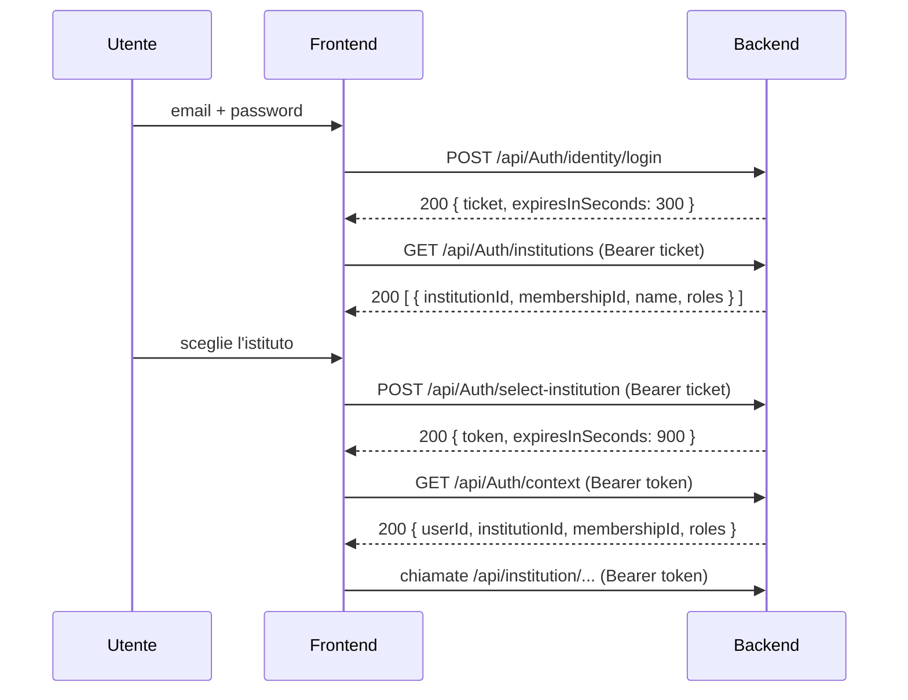

# Autenticazione e autorizzazione

Fonti: `src/Api/ElectronicRegisterAPI/Security/InstitutionAuthentication.cs`, `Security/InstitutionEndpointGate.cs`, `src/Infrastructure/ElectronicRegisterAPI.Infrastructure/Security/InstitutionTokens.cs`, `.../Security/InstitutionTokenContract.cs`, `src/Application/ElectronicRegisterAPI.Application/Managers/InstitutionAuthManager.cs`, `src/Domain/ElectronicRegisterAPI.Domain/Authorization/InstitutionPermissions.cs`.

---

## 1. Meccanismo

- **JWT Bearer** firmati **HS256** con chiave simmetrica (`Jwt:Key`), inviati nell'header `Authorization: Bearer <token>`.
- **Nessun cookie, nessuna sessione server, nessuna API key.**
- **Due tipi di token**, non intercambiabili:

| Token | Si ottiene da | Durata | Serve per |
|---|---|---|---|
| **Selection ticket** (`typ: er-selection+jwt`) | `POST /api/Auth/identity/login` o `POST /api/Auth/identity/microsoft-login` | **300 s (5 min)** | elencare gli istituti, scegliere l'istituto, gestire il proprio account, accettare un invito |
| **Access token istituzionale** (`typ: er-institution+jwt`) | `POST /api/Auth/select-institution` | **900 s (15 min)** | tutte le API `/api/institution/...` e `GET /api/Auth/context` |

Le durate sono **fisse nel codice** (`InstitutionTokens.cs` righe 15 e 20). Il valore `Jwt:ExpiresInMinutes` presente in `appsettings.example.json` **non è usato** ([OPEN_QUESTIONS Q-05](OPEN_QUESTIONS.md#q-05)).

Validazione lato server (utile per capire i 401): emittente, audience specifica per tipo (`<Audience>:institution-selection` / `<Audience>:institution-access`), scadenza **senza tolleranza** (`ClockSkew = 0`), algoritmo HS256, header `typ`, claim `purpose`. Ad ogni richiesta il server rilegge dal DB la **generation** dell'identità e, per l'access token, lo stato della membership: se sono cambiati, il token è rifiutato anche se non scaduto.

### Claim (per debug, il frontend non deve fidarsi di questi valori per l'autorizzazione)

| Claim | Selection | Access | Significato |
|---|---|---|---|
| `sub` | ✓ | ✓ | `userId` (GUID) |
| `jti`, `auth_time`, `purpose` | ✓ | ✓ | tecnici |
| `identity_generation` | ✓ | ✓ | contatore di sicurezza dell'account |
| `institution_id` | – | ✓ | istituto attivo |
| `membership_id` | – | ✓ | membership attiva |
| `security_generation` | – | ✓ | contatore di sicurezza della membership |
| `institution_role` | – | ✓ (ripetuto) | ruoli della membership |

Per conoscere ruoli e contesto usare **`GET /api/Auth/context`** invece di decodificare il JWT.

---

## 2. Flusso completo



### 2.1 Registrazione

`POST /api/identity/accounts`, **anonimo**.

```json
{ "email": "mario.rossi@example.org", "password": "Password!123" }
```

- `email`: obbligatoria, formato email valido, max 255 caratteri, **senza spazi iniziali/finali** (dopo il trim deve coincidere con l'indirizzo normalizzato).
- `password`: 8–72 caratteri, **almeno un carattere speciale** tra `!@#$%^&*()_-+=<>?/[]{}`, max **72 byte UTF-8** (`Domain/Policies/PasswordRules.cs`).
- Campi extra → 400.
- Risposta: **201** con body = GUID dell'utente (stringa JSON), senza header `Location`.
- Email già registrata → **409** `"Operazione non consentita"`.
- Non c'è verifica email.

> La registrazione crea **solo l'identità**. Senza una membership in un istituto, `GET /api/Auth/institutions` restituisce `[]` e l'utente non può fare altro che gestire il proprio account. Le membership si creano tramite inviti (vedi [OPEN_QUESTIONS Q-01](OPEN_QUESTIONS.md#q-01)).

### 2.2 Login con password

`POST /api/Auth/identity/login`, **anonimo**.

```json
{ "email": "mario.rossi@example.org", "password": "Password!123" }
```

- **200** → `{ "ticket": "<JWT>", "expiresInSeconds": 300 }`
- **401** → `{ "title": "Credenziali non valide", "status": 401, ... }` (email inesistente o password errata: stesso messaggio)

### 2.3 Login Microsoft (Entra ID)

`POST /api/Auth/identity/microsoft-login`, **anonimo**.

```json
{ "accessToken": "<access token Microsoft Entra ID>" }
```

- Il frontend ottiene l'access token da Microsoft (il frontend esistente usa `expo-auth-session`, vedi `Frontend/ElectronicRegisterReact/src/appConfig.js`).
- Il backend valida emittente `https://login.microsoftonline.com/{AzureAd:TenantId}/v2.0` e audience `AzureAd:Audience`, poi cerca il collegamento (`tid`, `oid`) → `userId` nella configurazione `Identity:Microsoft:Bindings`. **Email e `preferred_username` non vengono mai usati.**
- **200** → `{ "ticket", "expiresInSeconds": 300 }`. **401** → `"Identita non autorizzata"` (token non valido, tenant diverso, utente non collegato).
- Il collegamento account Microsoft ↔ utente è **solo da configurazione server**: non esiste un endpoint per crearlo.

### 2.4 Elenco istituti e selezione

1. `GET /api/Auth/institutions` con `Authorization: Bearer <ticket>` → elenco delle membership **attive** in istituti **attivi**.
2. `POST /api/Auth/select-institution` con il ticket:

```json
{
  "institutionId": "8f2c1a6e-3b0d-4c55-9a1e-2f4b6c7d8e90",
  "membershipId": "1d3e5f70-9a2b-4c4d-8e6f-0a1b2c3d4e5f",
  "requestedRole": "Teacher"
}
```

- `requestedRole` è **facoltativo** (max 32 caratteri). Se presente deve essere uno dei ruoli della membership, altrimenti **403**. **Non limita i privilegi**: il token contiene sempre **tutti** i ruoli della membership.
- **200** → `{ "token": "<JWT>", "expiresInSeconds": 900 }`.
- **403** se la membership non esiste, non è attiva, l'istituto non è attivo, o la sessione è stata revocata.

### 2.5 Contesto corrente

`GET /api/Auth/context` (access token) → `{ "userId", "institutionId", "membershipId", "roles": ["Staff","Teacher"] }` (ruoli in ordine alfabetico).

### 2.6 Refresh token

**Non esiste.** Quando l'access token scade (15 min):

- se il **selection ticket** è ancora valido (meno di 5 min dal login) si può richiamare `POST /api/Auth/select-institution`;
- altrimenti l'utente deve **rifare il login**.

Il frontend deve gestire la scadenza in modo proattivo (vedi [FRONTEND_CHECKLIST.md](FRONTEND_CHECKLIST.md#3-rischi-vincoli-e-attenzioni)) e conservare la password solo se lo ritiene accettabile (sconsigliato). Vedi [OPEN_QUESTIONS Q-04](OPEN_QUESTIONS.md#q-04).

### 2.7 Logout

**Non esiste un endpoint di logout.** Il logout è solo lato client: si scartano ticket e token. Un token rubato resta valido fino alla scadenza, salvo revoca indiretta (cambio password o modifica della membership, vedi §3).

### 2.8 Cambio password

`PUT /api/identity/account/password` con il **selection ticket**:

```json
{ "currentPassword": "Password!123", "newPassword": "NuovaPass#2026" }
```

- **204** in caso di successo. **Il cambio password revoca tutti i token esistenti** dell'utente (incremento dell'`identity_generation`): l'utente deve rifare il login.
- **403** credenziali attuali errate o account solo Microsoft (senza password locale), **400** nuova password non conforme o uguale alla precedente, **429** con `Retry-After: 60` se è in corso un altro tentativo di cambio password per lo stesso utente.

### 2.9 Recupero password

**Non esiste** (nessun endpoint "password dimenticata" / reset). Vedi [OPEN_QUESTIONS Q-04](OPEN_QUESTIONS.md#q-04).

---

## 3. Scadenza e revoca: cosa vede il frontend

| Situazione | Risposta | Azione consigliata |
|---|---|---|
| Header assente / token malformato / scaduto / firma errata | **401** `{"title":"Non autenticato","status":401}` + header `WWW-Authenticate: Bearer` | tornare al login (o riselezionare l'istituto se il ticket è ancora valido) |
| Password cambiata (identity generation cambiata) | **401** | login |
| Ruoli della membership modificati, membership sospesa, istituto sospeso (security generation cambiata) | **403** `{"title":"Non autorizzato","status":403}` | rifare `select-institution`; se fallisce, tornare all'elenco istituti |
| Ruolo non abilitato per l'endpoint | **403** | nascondere la funzione nella UI |
| Modulo disattivato (feature flag) | **403** (o **404** per calendario/piani formativi) | nascondere il modulo |
| Ticket usato al posto dell'access token (o viceversa) | **401** | errore di programmazione del client |

> Distinzione pratica: **401 = il token non vale più**, **403 = il token vale ma non basta**. Dopo un 403 su *qualsiasi* endpoint, conviene richiamare `GET /api/Auth/context`: se anche questo risponde 403, la membership è cambiata e serve una nuova selezione dell'istituto.

---

## 4. Ruoli e permessi

Ruoli istituzionali (`Domain/Enums/InstitutionRole.cs`): `InstitutionAdmin`, `Staff`, `Teacher`, `Student`. Una membership può avere **più ruoli contemporaneamente**: i permessi si sommano, con eccezioni per Staff descritte sotto.

Il controllo avviene su tre livelli:

1. **Ruolo richiesto dall'endpoint**, con `[Authorize(Roles=...)]` nel controller. È quello indicato in [API.md](API.md).
2. **Permessi applicativi** (`InstitutionPermissions.cs`), riassunti nella tabella sotto.
3. **Proprietà dei dati.** Un docente vede e modifica solo esami e voti delle classi-materie che insegna. Uno studente vede solo i propri dati. Serve anche un **profilo collegato** alla membership (studente o docente), altrimenti 403 `"Profilo istituzionale non disponibile."`.

### 4.1 Permessi applicativi (`Domain/Authorization/InstitutionPermissions.cs`)

| Permesso | InstitutionAdmin | Staff | Teacher | Student |
|---|:-:|:-:|:-:|:-:|
| UserRead | ✓ | ✓ | ✓ | – |
| UserCreate / UserUpdate | ✓ | ✓ | – | – |
| UserDelete | ✓ | **✗ sempre** | – | – |
| GradeRead | ✓ | ✓ | ✓ | ✓ (solo propri) |
| GradeCreate / GradeUpdate | ✓ | ✓ | ✓ (proprie classi-materie) | – |
| GradeDelete | ✓ | **✗ sempre** | – | – |
| ExamRead / Create / Update / Assign / Publish / Close | ✓ | ✓ | ✓ (propri) | – |
| ExamDelete / ExamCancel | ✓ | **✗ sempre** | ✓ (propri) | – |
| SubmissionRead | ✓ | ✓ | ✓ | – |
| SubmissionReview / SubmissionFinalize | ✓ | – | ✓ | – |

"✗ sempre": se la membership include **Staff** (e non InstitutionAdmin), questi permessi sono negati **anche se** la membership ha anche il ruolo Teacher.

### 4.2 Tabella "ruolo → cosa può fare" (dal punto di vista delle schermate)

| Funzionalità | InstitutionAdmin | Staff | Teacher | Student |
|---|:-:|:-:|:-:|:-:|
| Gestire membri, ruoli, sospensioni, audit, inviti | ✓ | – | – | – |
| Catalogo: aree, percorsi, bienni, sedi, classi | ✓ | – | – | – |
| Edizioni corso, iscrizioni, trasferimenti di classe | ✓ | – | – | – |
| Materie: lettura | ✓ | – ¹ | ✓ | ✓ |
| Materie: scrittura | ✓ | – | – | – |
| Classe↔materia↔docente: elenco | ✓ | – | ✓ | – |
| Classe↔materia↔docente: dettaglio/scrittura | ✓ | – | – | – |
| Studenti: lettura | ✓ | ✓ | ✓ | solo `me` |
| Studenti: creazione/modifica | ✓ | ✓ | – | – |
| Studenti: eliminazione | ✓ | – | – | – |
| Docenti: lettura | ✓ | ✓ | ✓ | ✓ |
| Docenti: creazione/modifica | ✓ | ✓ | – | – |
| Docenti: eliminazione | ✓ | – | – | – |
| Esami: gestione (crea, modifica, assegna, pubblica, chiudi) | ✓ | ✓ | ✓ (propri) | – |
| Esami: annulla / elimina | ✓ | – | ✓ (propri) | – |
| Esami: svolgimento (assegnati, avvio, risposte, consegna) | – | – | – | ✓ |
| Consegne: elenco, dettaglio, violazioni | ✓ | ✓ | ✓ (propri) | – |
| Consegne: correzione aperte e voto finale | ✓ | – | ✓ (propri) | – |
| Voti: lettura | ✓ | ✓ | ✓ (propri) | ✓ (propri) |
| Voti: inserimento/modifica | ✓ | ✓ | ✓ (propri) | – |
| Voti: eliminazione | ✓ | – | – | – |
| Calendario: gestione, pubblicazione, import, ore | ✓ | ✓ | – | – |
| Calendario: proprio calendario, segnare lezione svolta | – | – | ✓ | – |
| Calendario: proprio calendario | – | – | – | ✓ |
| Piani formativi: lettura | ✓ | ✓ | – | – |
| Piani formativi: scrittura e pubblicazione | ✓ | – | – | – |
| Piano formativo di un'edizione (lettura) | ✓ | ✓ | ✓ | ✓ |
| Email istituzionali: policy (lettura, anteprima) | ✓ | ✓ | – | – |
| Email istituzionali: policy (scrittura) | ✓ | – | – | – |
| Email istituzionali: assegnazioni (lettura) | ✓ | ✓ | ✓ | ✓ |
| Email istituzionali: prenotare, creare persona | ✓ | ✓ | – | – |
| Email istituzionali: override, ritiro, storico | ✓ | – | – | – |
| Import anagrafiche CSV/XLSX | ✓ | ✓ | – | – |
| Iscrizioni proprie (`enrollments/me`) | – | – | – | ✓ |

¹ Il servizio applicativo permetterebbe la lettura allo Staff, ma il controller non include il ruolo: vedi [OPEN_QUESTIONS Q-08](OPEN_QUESTIONS.md#q-08).

### 4.3 Regola speciale per Staff: campi sconosciuti

Per gli utenti **Staff senza InstitutionAdmin**, i `POST`/`PUT` su studenti, docenti, esami e voti che contengono **campi JSON non previsti** vengono rifiutati con **400 senza body** (`Security/StaffBodyContractAttribute.cs`). Inviare sempre e solo i campi documentati.

---

## 5. Esempi di invio credenziali

```bash
# 1. Login
curl -s -X POST http://127.0.0.1:5257/api/Auth/identity/login \
  -H "Content-Type: application/json" \
  -d '{"email":"mario.rossi@example.org","password":"<PASSWORD>"}'

# 2. Istituti (con il ticket)
curl -s http://127.0.0.1:5257/api/Auth/institutions -H "Authorization: Bearer <TICKET>"

# 3. Selezione istituto
curl -s -X POST http://127.0.0.1:5257/api/Auth/select-institution \
  -H "Authorization: Bearer <TICKET>" -H "Content-Type: application/json" \
  -d '{"institutionId":"<INSTITUTION_ID>","membershipId":"<MEMBERSHIP_ID>"}'

# 4. API istituzionali (con l'access token)
curl -s http://127.0.0.1:5257/api/Auth/context -H "Authorization: Bearer <ACCESS_TOKEN>"
```

Esempio di client (axios), pensato per i due token:

```ts
const api = axios.create({ baseURL: API_BASE });
api.interceptors.request.use((cfg) => {
  const usesTicket = /^\/api\/(identity\/account|Auth\/institutions|Auth\/select-institution|Auth\/invitations)/.test(cfg.url ?? "");
  const token = usesTicket ? session.ticket : session.accessToken;
  if (token) cfg.headers.Authorization = `Bearer ${token}`;
  return cfg;
});
```

### Riepilogo: quale token per quale endpoint

| Endpoint | Token |
|---|---|
| `POST /api/identity/accounts`, `POST /api/Auth/identity/login`, `POST /api/Auth/identity/microsoft-login`, `GET /health/*` | nessuno |
| `GET/PUT /api/identity/account`, `PUT /api/identity/account/password`, `GET /api/Auth/institutions`, `POST /api/Auth/select-institution`, `POST /api/Auth/invitations/{id}/accept` | **selection ticket** |
| `GET /api/Auth/context` e tutti gli `/api/institution/...` | **access token** |
