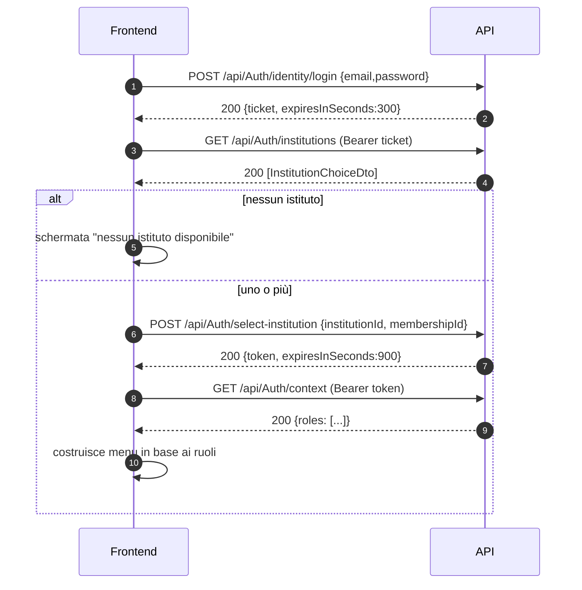
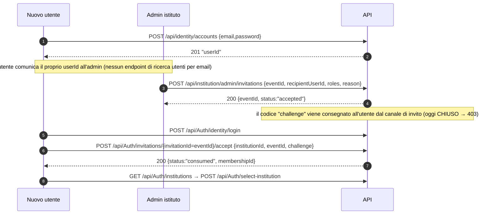
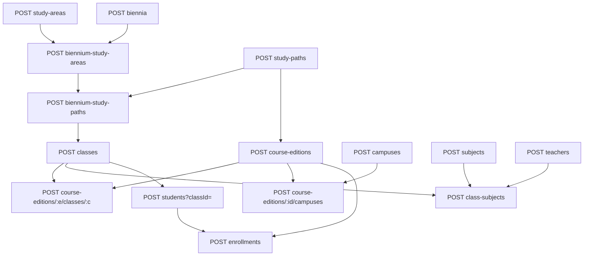
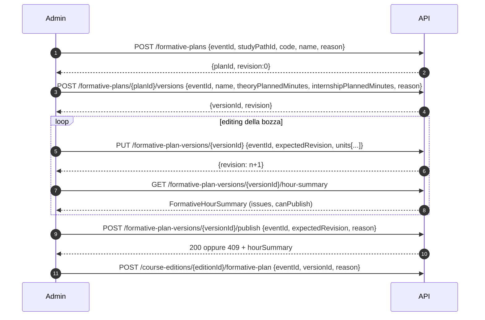
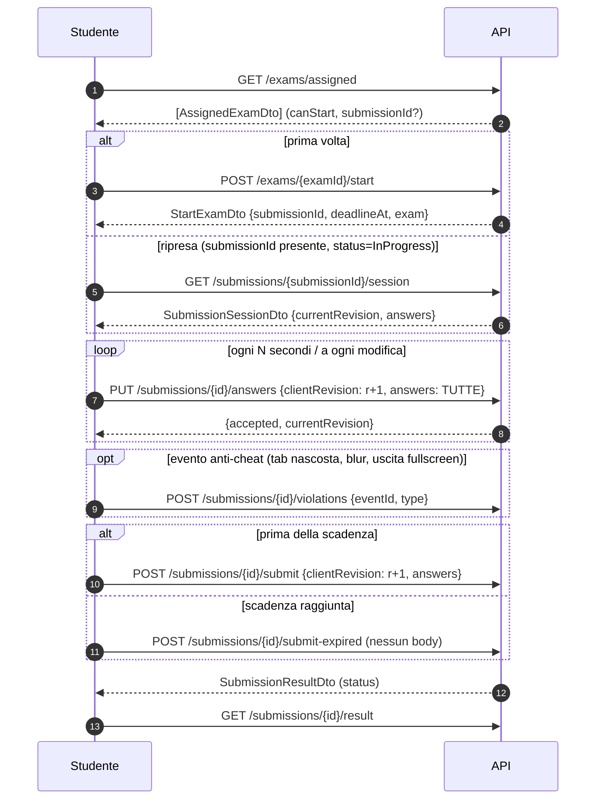
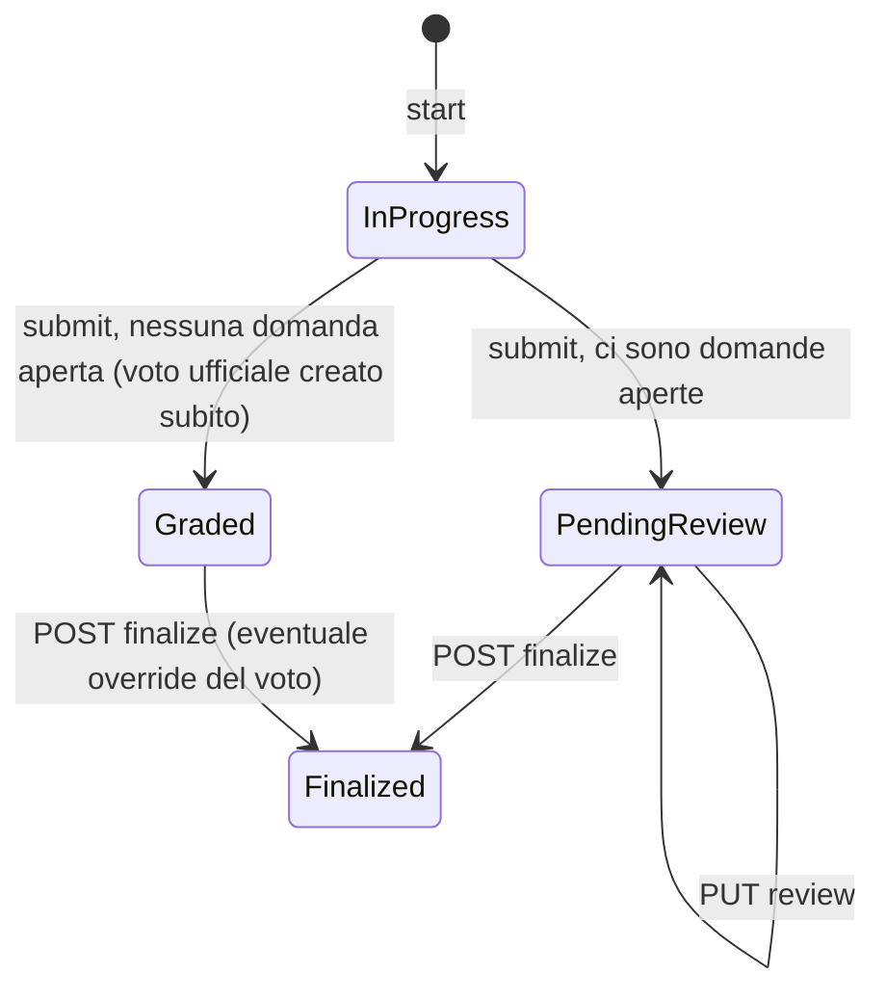
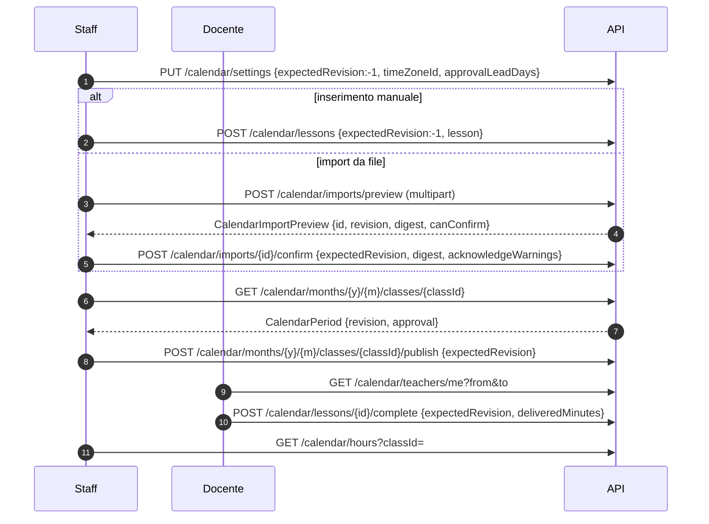
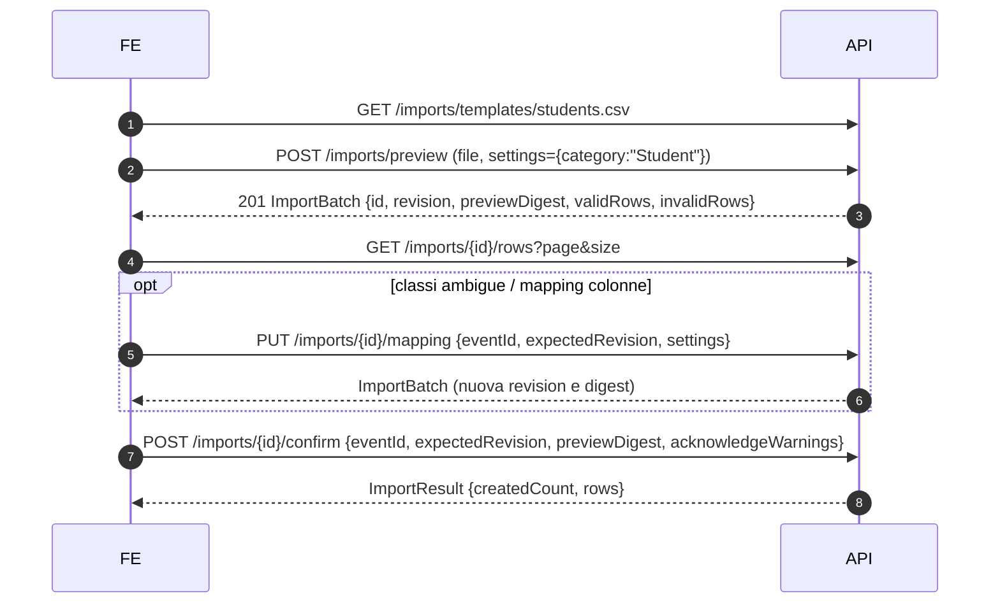

# Flussi applicativi end-to-end

Sequenze di chiamate per i casi d'uso principali. Dettagli di ogni endpoint in [API.md](API.md), tipi in [MODELS.md](MODELS.md).
In tutti i flussi `eventId` è un UUID generato dal client **una volta per azione** e riusato nei retry ([CONVENTIONS §1.4](CONVENTIONS.md#14-eventid-idempotenza-dei-comandi)).

---

## 1. Accesso: login → scelta istituto → sessione

**Dati da passare:** il `ticket` serve per i passi 3–5; `institutionId` e `membershipId` arrivano dalla risposta del passo 4; il `token` si usa per tutto il resto.

**Casi limite:**
- **Il ticket scade dopo 5 minuti.** Se l'utente resta a lungo sulla schermata di scelta dell'istituto, la selezione risponde 401 e serve un nuovo login.
- **L'access token scade dopo 15 minuti e non c'è refresh.** Strategia consigliata:
  1. salvare l'istante di scadenza (`Date.now() + expiresInSeconds*1000`);
  2. prima della scadenza mostrare un avviso;
  3. alla scadenza riportare al login.
  4. Con un ticket ancora valido si può riselezionare l'istituto senza password.
- **Una membership modificata (ruoli, sospensione) fa scattare un 403** anche con token valido: rifare la selezione.
- **Login Microsoft:** passo 1 sostituito da `POST /api/Auth/identity/microsoft-login {accessToken}`.
- **Cambio istituto:** serve un ticket valido. Altrimenti si rifà il login.

---

## 2. Registrazione e ingresso in un istituto

**Casi limite:**
- Con il canale di consegna chiuso (stato attuale del codice), i passi invito, ri-emissione e accettazione rispondono **403**. Le membership oggi vanno create fuori dalle API. Vedi [OPEN_QUESTIONS Q-01](OPEN_QUESTIONS.md#q-01) e [Q-10](OPEN_QUESTIONS.md#q-10).
- La sfida scade dopo 15 minuti e ammette al massimo 5 tentativi. In quei casi serve `POST .../reissue`.
- La risposta all'invito è sempre `accepted`, anche se l'utente non esiste: l'admin non può dedurre se l'invito è partito davvero.

---

## 3. Configurazione iniziale dell'istituto (InstitutionAdmin)

Ordine obbligato dalle dipendenze tra entità:

| Passo | Chiamata | Dato da conservare |
|---|---|---|
| 1 | `POST /api/institution/study-areas` | `studyAreaId` |
| 2 | `POST /api/institution/biennia` | `bienniumId` |
| 3 | `POST /api/institution/biennium-study-areas {bienniumId, studyAreaId}` | `bienniumStudyAreaId` |
| 4 | `POST /api/institution/study-paths` | `studyPathId` |
| 5 | `POST /api/institution/biennium-study-paths {bienniumStudyAreaId, studyPathId}` | `bienniumStudyPathId` |
| 6 | `POST /api/institution/course-editions {studyPathId, code, name, status:"planned"}` | `courseEditionId` |
| 7 | `POST /api/institution/classes {name, bienniumStudyPathId}` | `classId` |
| 8 | `POST /api/institution/course-editions/{courseEditionId}/classes/{classId}` | – |
| 9 | `POST /api/institution/campuses` → `POST /course-editions/{id}/campuses {campusId}` | `campusId` |
| 10 | `POST /api/institution/subjects`, `POST /api/institution/teachers` | `subjectId`, `teacherId` |
| 11 | `POST /api/institution/class-subjects {classId, subjectId, teacherId}` | `classSubjectId` |
| 12 | `POST /api/institution/students?classId={classId}` | `studentId` |
| 13 | `POST /api/institution/enrollments {studentId, courseEditionId, enrollmentDate, status:"enrolled"}` | `enrollmentId` |

**Collegare un utente al suo profilo**, perché docenti e studenti vedano "i propri" dati:
- in creazione: `POST /teachers?membershipId=` o `POST /students?membershipId=`, solo InstitutionAdmin;
- dopo: `POST /admin/members/{membershipId}/profile-acquisitions`.

Senza questo collegamento, gli endpoint "me" e le funzioni docente o studente rispondono **403** `"Profilo istituzionale non disponibile."`.

**Casi limite:**
- Ogni `PUT` del catalogo richiede `If-Match` con la `revision` corrente ([CONVENTIONS §4.1](CONVENTIONS.md#41-etag--if-match-catalogo)).
- Una classe può appartenere a una sola edizione: riassegnarla dà 409.
- Non si possono eliminare entità con dipendenze (409).

---

## 4. Piano formativo e collegamento all'edizione

**Casi limite:**
- La somma dei `plannedMinutes` dei moduli deve essere uguale a `theoryPlannedMinutes`, altrimenti c'è l'issue `theory.total-mismatch`.
- Ogni modulo deve avere una `subjectId` valida.
- Una versione pubblicata non si modifica: si usa `clone` per creare una nuova bozza.
- Gli `id` di unità, moduli e argomenti vanno **rimandati** nel `PUT` per mantenerne l'identità. Le lezioni del calendario puntano ai moduli.

---

## 5. Svolgimento esame (studente)

**Dati da passare tra le chiamate:**
- `submissionId`: arriva da `start` o da `assigned`.
- `deadlineAt`: serve per il timer lato client. Usarlo **così com'è**, perché include già il tempo extra.
- `clientRevision`: contatore locale. Parte da `currentRevision` della sessione (0 dopo `start`) e si incrementa **prima di ogni** salvataggio o consegna.

**Casi limite:**
- **`accepted: false`**: il server ha già una revisione ≥ di quella inviata (ad esempio un altro tab). Riallineare con `currentRevision` e reinviare, oppure ricaricare la sessione.
- **`submit` con `clientRevision` non crescente** → 409 `"Impossibile salvare le risposte inviate."`. Incrementare sempre.
- **`submit` dopo la scadenza** → 409: chiamare `submit-expired`.
- **`submit-expired` prima della scadenza** → 409. Il controllo usa l'orologio del server: aggiungere qualche secondo di margine o ritentare.
- **Domande obbligatorie senza risposta** → 400 sul `submit`.
- **Il worker automatico** chiude le consegne scadute solo se `Multitenancy:InstitutionWorker:Enabled=true`. Altrimenti la consegna resta `InProgress` finché il client non chiama `submit-expired`: il frontend deve farlo **sempre** allo scadere del timer.
- **`start` non è idempotente**: dopo un errore di rete, rileggere `GET /exams/assigned` per ottenere il `submissionId` prima di riprovare.
- **Limiti sulle violazioni**: al massimo 5 ogni 10 secondi (aggregare gli eventi lato client) e 128 in totale. Le violazioni non chiudono l'esame.
- **Rate limit**: `submit` e `violations` sono `POST` e rientrano nel limite per IP (default 60/min, [CONVENTIONS §5](CONVENTIONS.md#5-rate-limiting)).

---

## 6. Correzione e voto finale (docente)

| Passo | Chiamata | Note |
|---|---|---|
| 1 | `GET /api/institution/exams` | esami del docente |
| 2 | `GET /api/institution/exams/{examId}/submissions?status=2` | `2` = PendingReview |
| 3 | `GET /api/institution/submissions/{id}/review` | `answers[].answerId` delle domande aperte (`questionType: 2`) |
| 4 | `GET /api/institution/submissions/{id}/violations` | facoltativo |
| 5 | `PUT /api/institution/submissions/{id}/review {answers:[{answerId, awardedPoints, comment}]}` | quando tutte le aperte sono corrette compare `suggestedGrade` |
| 6 | `POST /api/institution/submissions/{id}/finalize {finalGrade:null}` | oppure un voto diverso con `overrideReason` |
| 7 | `GET /api/institution/submissions/{id}/result` | `grade`, `passed` |

**Casi limite:**
- `finalize` con risposte aperte non ancora corrette → 409.
- Una consegna con voto ufficiale non si ricorregge: `review` → 409.
- Il voto finale crea un `Grade`, che **non** è modificabile o eliminabile da `/grades`: 409.
- **Esame senza domande aperte**: al `submit` la consegna passa a `Graded` e il voto (calcolato con la formula di [MODELS §3.8](MODELS.md#38-esami)) viene **registrato subito** come voto ufficiale. Lo studente lo vede immediatamente.
- **`FailedAuto (3)`** esiste nell'enum, ma il codice di consegna attuale non lo assegna mai ([OPEN_QUESTIONS Q-14](OPEN_QUESTIONS.md#q-14)). Gestirlo comunque in UI.

---

## 7. Creazione e pubblicazione esame (docente / staff)

1. `GET /api/institution/class-subjects`: scegliere la classe-materia (`classSubjectId`).
2. `POST /api/institution/exams`: crea la bozza e restituisce `examId`. Il nome è quello della materia.
3. `GET /api/institution/exams/{examId}/eligible-students` → `PUT /api/institution/exams/{examId}/students`, se gli studenti non sono stati indicati in creazione.
4. `GET /api/institution/exams/{examId}`: anteprima con le risposte corrette.
5. `POST /api/institution/exams/{examId}/publish`.
6. Dopo l'esame: `POST /api/institution/exams/{examId}/close`. Non è possibile finché ci sono consegne `InProgress`.

**Casi limite:**
- Dopo la pubblicazione domande e studenti non si modificano più.
- **Annullare** è possibile solo se nessuno ha iniziato.
- **Eliminare** è possibile solo in bozza.
- Per un **recupero**: creare un nuovo esame con `retakeOfExamId` dell'esame originale, sulla stessa classe-materia.

---

## 8. Calendario: dalla pianificazione alle ore erogate (staff)

**Prerequisiti:** [flusso 3](#3-configurazione-iniziale-dellistituto-institutionadmin) (classe, edizione, classe-materia) e [flusso 4](#4-piano-formativo-e-collegamento-alledizione) (piano pubblicato e collegato).

**Casi limite:**
- Le lezioni in bozza **non** sono visibili a docenti e studenti finché il mese non viene pubblicato.
- Orari che cadono nel cambio dell'ora legale vengono rifiutati.
- Il docente che non è quello della classe-materia richiede `substitutionReason`.
- `approval.isLate` / `isOverdue` indicano che la pubblicazione del mese è in ritardo rispetto ai giorni di preavviso.

---

## 9. Import anagrafiche da file (admin / staff)

**Casi limite:**
- **L'anteprima scade dopo 30 minuti** (409 `PreviewExpired`): mostrare un countdown basato su `expiresAtUtc`.
- **Reimportare lo stesso file** richiede `allowRepeatedFile: true` e una `reason`.
- **Righe non valide alla conferma** → 422: correggere il file o il mapping.
- **Massimo 2 upload contemporanei**, poi 429.

---

## 10. Gestione ruoli di un membro (admin)

1. `GET /api/institution/admin/members?search=rossi` → `membershipId`.
2. `GET /api/institution/admin/audit?target={membershipId}`: l'ultimo `revisionAfter` è la `expectedRevision` corrente. È l'unica fonte disponibile: [OPEN_QUESTIONS Q-06](OPEN_QUESTIONS.md#q-06).
3. `POST /api/institution/admin/members/{membershipId}/mutations {eventId, expectedRevision, action:"AddRole", role:"Staff", reason}`.
4. La risposta contiene la nuova `revision`, da usare per la mutazione successiva.

**Casi limite:**
- Rimuovere o sospendere l'ultimo admin attivo → 409.
- L'utente modificato deve riselezionare l'istituto: il suo token riceve 403.

---

## 11. Trasferimento di classe (admin)

1. `GET /api/institution/students/{id}/class-history` → `currentRevision`.
2. `POST /api/institution/students/{id}/transfer-class {eventId, toClassId, effectiveDate, reason, expectedRevision: currentRevision}`.
3. In caso di 409 `Trasferimento non consentito` mostrare `detail`, ad esempio "finestra scaduta".

---

## 12. Email istituzionali (admin / staff)

1. Admin: `POST /email-policies/Student {expectedRevision:0, state:"Published", template}`.
2. `POST /email-policies/preview {category, firstName, lastName}` per mostrare l'anteprima.
3. Riservare l'indirizzo:
   - persona esistente: `POST /email-assignments {category, policyRevision, recipient:{studentId}}`;
   - nuova persona: `POST /email-assignments/create-person`.
4. In caso di conflitto (409 "Indirizzo non disponibile"): l'admin usa `POST /email-assignments/{id}/override`.
