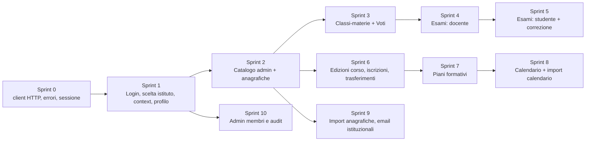

# Guida per il frontend (taglio Project Manager)

Obiettivo: pianificare lo sviluppo dell'interfaccia sulle API esistenti, sapendo in anticipo dipendenze, rischi e lacune.
Riferimenti: [API.md](API.md) · [AUTH.md](AUTH.md) · [FLOWS.md](FLOWS.md) · [OPEN_QUESTIONS.md](OPEN_QUESTIONS.md).

---

## 1. Schermate suggerite e endpoint necessari

### 1.1 Fondamenta (tutti i ruoli)

| Schermata / funzione | Ruoli | Endpoint |
|---|---|---|
| Login email/password | – | `POST /api/Auth/identity/login` |
| Login Microsoft | – | `POST /api/Auth/identity/microsoft-login` |
| Registrazione account | – | `POST /api/identity/accounts` |
| Scelta istituto | tutti | `GET /api/Auth/institutions`, `POST /api/Auth/select-institution` |
| Bootstrap sessione e menu per ruolo | tutti | `GET /api/Auth/context` |
| Profilo account (nome, cambio password) | tutti | `GET/PUT /api/identity/account`, `PUT /api/identity/account/password` |
| Accettazione invito | tutti | `POST /api/Auth/invitations/{id}/accept` (oggi non operativo, [Q-01](OPEN_QUESTIONS.md#q-01)) |

### 1.2 Amministrazione istituto (InstitutionAdmin)

| Schermata | Endpoint |
|---|---|
| Elenco membri con filtri e ricerca | `GET /api/institution/admin/members` |
| Dettaglio membro: ruoli, sospensione | `GET /admin/members/{id}`, `POST /admin/members/{id}/mutations`, `GET /admin/audit?target=` |
| Collegamento profilo storico | `GET/POST /admin/members/{id}/profile-acquisitions` |
| Inviti | `POST /admin/invitations`, `/{id}/revoke`, `/{id}/reissue` |
| Audit membership | `GET /admin/audit`, `GET /admin/audit/{eventId}` |
| Catalogo: aree, percorsi, bienni, associazioni | `study-areas`, `study-paths`, `biennia`, `biennium-study-areas`, `biennium-study-paths` (CRUD) |
| Sedi | `campuses` (CRUD) |
| Classi | `classes` (CRUD) |
| Materie | `subjects` (CRUD) |
| Assegnazioni classe-materia-docente | `class-subjects` (CRUD) |
| Edizioni corso: dettaglio con tab sedi, classi, iscritti, audit | `course-editions` e sotto-risorse |
| Iscrizioni: elenco per studente, transizioni, storico | `enrollments`, `/{id}/transition`, `/{id}/completion-date`, `/{id}/history` |
| Trasferimento di classe | `POST /students/{id}/transfer-class`, `GET /students/{id}/class-history` |
| Piani formativi: editor unità/moduli, validazione ore, pubblicazione | `formative-plans`, `formative-plan-versions/*`, `course-editions/{id}/formative-plan` |
| Policy email | `email-policies/*` |

### 1.3 Segreteria (Staff) e Admin

| Schermata | Endpoint |
|---|---|
| Anagrafica studenti | `GET/POST/PUT /students`, `GET /students/bylastname/{x}`, `GET /students/count` |
| Anagrafica docenti | `GET/POST/PUT /teachers`, `GET /teachers/bylastname/{x}` |
| Import anagrafiche (wizard) | `GET /imports/templates/*.csv`, `POST /imports/preview`, `GET /imports/{id}/rows`, `PUT /imports/{id}/mapping`, `POST /imports/{id}/confirm`, `GET /imports/{id}/result`, `GET /imports` |
| Calendario: vista mese/settimana, editor lezione | `GET /calendar`, `GET /calendar/classes/{id}`, `POST/PUT /calendar/lessons`, `cancel`, `reschedule`, `substitute` |
| Pubblicazione mensile per classe | `GET /calendar/months/{y}/{m}/classes/{id}`, `POST .../publish` |
| Import calendario | `POST /calendar/imports/preview`, `GET /calendar/imports/{id}`, `POST /calendar/imports/{id}/confirm` |
| Report ore per classe | `GET /calendar/hours?classId=` |
| Impostazioni calendario | `GET/PUT /calendar/settings` |
| Email istituzionali: anteprima, riserva, nuova persona | `POST /email-policies/preview`, `POST /email-assignments`, `POST /email-assignments/create-person`, `GET /email-assignments` |
| Voti (inserimento e modifica) | `GET /grades/paged`, `GET /grades/filters`, `POST/PUT /grades` |
| Esami (gestione) | vedi §1.4 |

### 1.4 Docente (Teacher)

| Schermata | Endpoint |
|---|---|
| Dashboard docente | `GET /teachers/me`, `GET /calendar/teachers/me`, `GET /exams`, `GET /grades/statistics` |
| Le mie classi-materie | `GET /class-subjects` |
| Studenti di una classe | `GET /students?classId=` |
| Registro voti | `GET /grades/paged`, `GET /grades/filters`, `POST/PUT /grades` |
| Editor esame (domande, opzioni, tempo extra) | `POST/PUT /exams`, `GET /exams/{id}/eligible-students`, `PUT /exams/{id}/students` |
| Ciclo di vita esame | `POST /exams/{id}/publish`, `close`, `cancel`, `DELETE /exams/{id}` |
| Consegne e correzione | `GET /exams/{id}/submissions`, `GET/PUT /submissions/{id}/review`, `GET /submissions/{id}/violations`, `POST /submissions/{id}/finalize`, `GET /submissions/{id}/result` |
| Lezioni svolte | `POST /calendar/lessons/{id}/complete`, `GET /calendar/lessons/{id}/module` |
| Piano formativo del corso | `GET /course-editions/{id}/formative-plan` |

### 1.5 Studente (Student)

| Schermata | Endpoint |
|---|---|
| Profilo e iscrizioni | `GET /students/me`, `GET /enrollments/me` |
| Orario / calendario | `GET /calendar/students/me`, `GET /calendar/lessons/{id}`, `GET /calendar/lessons/{id}/module` |
| Libretto voti e medie | `GET /grades`, `GET /grades/paged`, `GET /grades/statistics` |
| Esami assegnati | `GET /exams/assigned` |
| Svolgimento esame (timer, autosave, anti-cheat) | `POST /exams/{id}/start`, `GET /submissions/{id}/session`, `PUT /submissions/{id}/answers`, `POST /submissions/{id}/violations`, `POST /submissions/{id}/submit`, `POST /submissions/{id}/submit-expired` |
| Esito ed elaborato | `GET /submissions/{id}/result`, `GET /submissions/{id}/work` |
| Docenti e materie | `GET /teachers`, `GET /subjects` |
| Il mio indirizzo email istituzionale | `GET /email-assignments` |

---

## 2. Dipendenze e ordine di sviluppo consigliato

| Ordine | Blocco | Perché prima |
|---|---|---|
| 0 | **Infrastruttura client** | Tutto il resto ne dipende. Comprende: client HTTP con i due token, parser ProblemDetails, gestione di 401/403/409/429, generatore di `eventId`, conversione degli enum numerici, gestione dei campi `null` omessi. |
| 1 | Autenticazione e sessione | Senza access token non si chiama nessuna API istituzionale. |
| 2 | Catalogo e anagrafiche | Classi, materie, docenti e studenti sono prerequisiti di esami, voti e calendario. |
| 3 | Classi-materie e voti | Valore immediato per i docenti, complessità bassa. |
| 4–5 | Esami | Area più complessa (timer, autosave, revisioni, anti-cheat). Va iniziata presto. |
| 6–7 | Corsi e piani formativi | Prerequisiti obbligatori del calendario. |
| 8 | Calendario | Dipende da edizione, classe, piano pubblicato e classi-materie. |
| 9–10 | Import, email, admin membri | Funzioni amministrative a minor frequenza d'uso; dipendono da feature flag spesso spenti. |

**Prima di ogni sprint**, verificare con chi gestisce l'ambiente che i **feature flag** del modulo siano attivi ([CONVENTIONS §8](CONVENTIONS.md#8-feature-flag-e-moduli-disattivati)). Di default sono tutti spenti.

---

## 3. Rischi, vincoli e attenzioni

### 3.1 Sessione e sicurezza

| Rischio | Impatto | Mitigazione |
|---|---|---|
| Access token di 15 minuti senza refresh | logout frequenti, perdita di dati nei form lunghi (es. editor del piano formativo, editor esame) | timer di scadenza visibile, salvataggio locale delle bozze, riselezione dell'istituto se il ticket è ancora valido. Da discutere col backend ([Q-04](OPEN_QUESTIONS.md#q-04)). |
| Esame più lungo di 15 minuti | lo studente perde il token **durante l'esame** | flusso di "re-login rapido" che riporta alla sessione con `GET /submissions/{id}/session`; autosave frequente. **Rischio alto.** |
| Membership modificata durante l'uso | 403 improvvisi | dopo un 403 inatteso, richiamare `/api/Auth/context` e guidare l'utente alla riselezione. |
| Token in storage del browser | furto via XSS | preferire memoria o `sessionStorage` (il frontend attuale usa `sessionStorage`); mai nei log. |
| Dati sensibili | voti, risposte d'esame, email istituzionali, audit con `beforeJson`/`afterJson` | non mettere questi dati in cache persistente; il server invia comunque `Cache-Control: no-store`. |

### 3.2 Operazioni non idempotenti o delicate

| Operazione | Attenzione |
|---|---|
| `POST /exams/{id}/start` | non idempotente: un retry cieco dà 409. Dopo un errore rileggere `GET /exams/assigned`. |
| `POST` di creazione nel catalogo, anagrafiche, esami e voti | nessun `eventId`: un doppio click crea duplicati. Disabilitare il pulsante durante la richiesta. |
| Comandi con `eventId` (calendario, piani, email, import, membership, iscrizioni, trasferimenti, violazioni) | idempotenti **solo se** si riusa lo stesso `eventId` con lo stesso payload. Generarlo alla pressione del pulsante, non a ogni retry. |
| `PUT /exams/{id}` | **ricrea** domande e opzioni con nuovi ID: non conservare ID di domande lato client dopo un update. |
| `PUT /formative-plan-versions/{id}` | sostituzione completa: inviare **tutta** la struttura con gli `id` esistenti. |
| `PUT /submissions/{id}/answers` | sostituisce **tutte** le risposte: inviare sempre lo stato completo, non solo la domanda modificata. |
| `POST /admin/members/{id}/mutations` | può bloccare l'utente (sospensione) o togliere privilegi all'admin stesso. Chiedere conferma. |
| `DELETE` | nessun soft delete: chiedere sempre conferma. |

### 3.3 Prestazioni e volumi

- **Endpoint non paginati**, potenzialmente pesanti: `GET /students`, `GET /teachers`, `GET /subjects`, `GET /grades`, `GET /exams`. Preferire `GET /grades/paged` e i filtri (`?classId=`). Usare cache in memoria per sessione.
- **Paginazione eterogenea** e talvolta **senza totale** (membri, edizioni, iscrizioni): usare uno scroll "carica altro" che si ferma quando la pagina restituita è più corta di `pageSize`.
- **`X-Total-Count` e `ETag` non leggibili cross-origin** ([Q-03](OPEN_QUESTIONS.md#q-03)). Per `If-Match` usare `revision` dal body; per sedi e classi-materie non affidarsi al totale.
- **Calendario**: massimo 100 lezioni per pagina e 366 giorni per intervallo. Per una vista mensile di più classi occorre paginare.
- **Upload import**: fino a 10 MiB per l'import anagrafiche (configurabile), 12 MiB per il calendario. Massimo 2 upload contemporanei. Mostrare una barra di avanzamento; l'elaborazione è sincrona.
- **Rate limit**: 60 `POST`/min per IP. In aula (tutti dietro lo stesso NAT) le consegne contemporanee di un esame possono superarlo ([Q-11](OPEN_QUESTIONS.md#q-11)). Gestire 429 con un retry automatico dopo `Retry-After` per `submit`.

### 3.4 Formati da gestire con cura

- **Enum numerici** negli esami: `status`, `type`, `submitReason`. Altrove gli enum sono stringhe ([CONVENTIONS §1.1](CONVENTIONS.md#11-enum-attenzione-due-formati-diversi)).
- **Campi `null` omessi**: ad esempio `description` assente, non `null`.
- **Date**: inviare in UTC con `Z` i `DateTime` degli esami; le date senza ora come `YYYY-MM-DD`; gli orari delle lezioni come `HH:mm:00`.
- **Stringhe di stato** in minuscolo per membership e iscrizioni, in PascalCase per lezioni e policy email.
- **`metadata` delle violazioni**: è una **stringa** che contiene JSON, non un oggetto.

### 3.5 UX derivata dalle regole

- **Esami**: disabilitare "Modifica" se `status ≠ 0`; "Annulla" solo se pubblicato e senza consegne; "Elimina" solo in bozza. Mostrare `canStart` allo studente.
- **Calendario**: evidenziare le lezioni `Draft`; mostrare `approval.isLate` / `isOverdue`; i warning ore (`under-scheduled`, ecc.) sono informativi, non bloccanti.
- **Piano formativo**: mostrare in tempo reale il riepilogo ore (`GET .../hour-summary`) e le `issues`; il pulsante Pubblica è attivo solo se `canPublish`.
- **Import**: mostrare il countdown della scadenza (`expiresAtUtc`), le righe con `status ≠ Valid` e la scelta delle classi in `classCandidates`.

---

## 4. Funzionalità incomplete, mancanti o da chiarire

| Funzionalità | Stato nel backend | Effetto sul frontend |
|---|---|---|
| Refresh token / logout server | **mancante** | sessioni di 15 minuti; logout solo lato client |
| Recupero / reset password | **mancante** | nessuna schermata "password dimenticata" |
| Verifica email alla registrazione | **mancante** | – |
| Ricerca utenti per email (per invitare) | **mancante** | l'admin deve conoscere il `userId` del destinatario ([Q-10](OPEN_QUESTIONS.md#q-10)) |
| Inviti | **non operativi** (canale di consegna chiuso) | progettare le schermate, ma prevedere 403 ([Q-01](OPEN_QUESTIONS.md#q-01)) |
| Creazione istituto / primo admin | **nessun endpoint HTTP** | onboarding iniziale fuori dal frontend ([Q-10](OPEN_QUESTIONS.md#q-10)) |
| Scoperta dei moduli attivi | **mancante** | nascondere i moduli dopo un 403/404, oppure configurazione concordata ([Q-09](OPEN_QUESTIONS.md#q-09)) |
| Lettura delle materie per lo Staff | **bloccata dal controller** | lo Staff non può popolare menu di materie ([Q-08](OPEN_QUESTIONS.md#q-08)) |
| `ExpectedRevision` dei membri | **non esposta** nel DTO del membro | serve l'audit per ricavarla ([Q-06](OPEN_QUESTIONS.md#q-06)) |
| Stato `FailedAuto` degli esami | **mai assegnato** dal codice attuale | gestirlo comunque in UI ([Q-14](OPEN_QUESTIONS.md#q-14)) |
| Notifiche in tempo reale | **assenti** (niente WebSocket/SSE) | polling, ad esempio sull'elenco consegne durante un esame |
| Email reali | **non inviate**: solo riserva di indirizzi | non promettere all'utente l'attivazione della casella |
| Swagger / OpenAPI | solo in Development (`/openapi/v1.json`) | generare i client in dev ([Q-20](OPEN_QUESTIONS.md#q-20)) |

---

## 5. Checklist di integrazione

- [ ] Client HTTP con selezione automatica di ticket o access token ([AUTH §5](AUTH.md#5-esempi-di-invio-credenziali)).
- [ ] Gestione della scadenza (`expiresInSeconds`) e degli eventi 401/403.
- [ ] Parser `ProblemDetails` più varianti: body vuoto su 400, `{code}` per il calendario, `errors` di validazione.
- [ ] Mappa dei `code` di calendario e import su messaggi in italiano.
- [ ] Enum numerici per gli esami ([MODELS §2.1](MODELS.md#21-enum-serializzati-come-numero)).
- [ ] Generatore `eventId` (UUID v4) legato all'azione utente.
- [ ] `If-Match` per i `PUT` del catalogo, costruito da `revision`.
- [ ] Retry con backoff su 429, rispettando `Retry-After`.
- [ ] Timer d'esame basato su `deadlineAt` del server, autosave con `clientRevision` crescente, chiamata a `submit-expired` alla scadenza.
- [ ] Origine del frontend aggiunta a `Transport:AllowedOrigins` in ogni ambiente.
- [ ] Feature flag concordati per ambiente.
