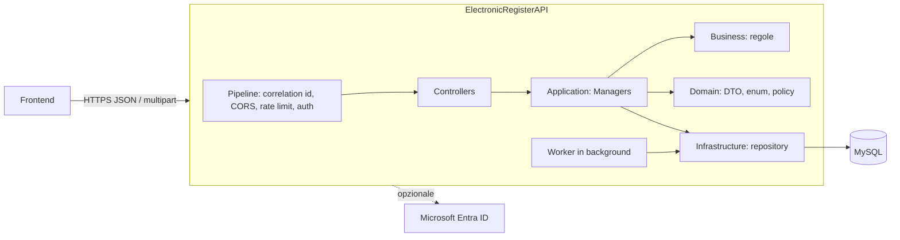

# ElectronicRegister API: documentazione per il frontend

Documentazione del backend `Backend/ElectronicRegisterAPI` per chi deve costruire l'interfaccia utente **senza leggere i sorgenti**.
Tutto ciò che è scritto qui deriva dal codice; ciò che non è deducibile è elencato in [OPEN_QUESTIONS.md](OPEN_QUESTIONS.md).

> Fonte principale: `Backend/ElectronicRegisterAPI/src/Api/ElectronicRegisterAPI/Program.cs` e i controller in `.../Controllers/`.

---

## 1. Cosa fa il backend

È il backend di un **registro elettronico multi-istituto** (scuole / enti di formazione). Ogni utente ha **un'identità unica** (email + password o account Microsoft) e può essere **membro di più istituti**, con uno o più ruoli in ciascuno (`InstitutionAdmin`, `Staff`, `Teacher`, `Student`). Tutti i dati operativi sono **isolati per istituto**: l'istituto attivo è deciso dal token, mai da parametri della richiesta.

Funzionalità esposte via HTTP:

| Area | Cosa permette |
|---|---|
| Identità | registrazione account, login (password o Microsoft), profilo, cambio password |
| Selezione istituto | elenco istituti dell'utente, emissione del token istituzionale |
| Membri e audit | elenco membri, aggiunta/rimozione ruoli, sospensione, audit, collegamento profili storici |
| Inviti | invito, revoca, ri-emissione, accettazione (vedi limiti in [OPEN_QUESTIONS](OPEN_QUESTIONS.md#q-01)) |
| Catalogo accademico | aree di studio, percorsi, bienni, associazioni biennio↔area↔percorso, sedi (campus), classi |
| Corsi | edizioni dei corsi, sedi collegate, classi assegnate, iscrizioni studenti con storico |
| Anagrafiche | studenti, docenti, materie, assegnazioni classe↔materia↔docente, trasferimento di classe |
| Esami | creazione esami con domande, assegnazione studenti, pubblicazione, svolgimento, consegna, correzione, voto finale, segnalazioni anti-cheat |
| Voti | voti manuali, statistiche, filtri |
| Calendario | lezioni, pubblicazione mensile, annullamento/spostamento/sostituzione, ore erogate, import da file |
| Piani formativi | piani, versioni, unità/moduli, validazione ore, pubblicazione, collegamento a edizioni corso |
| Email istituzionali | policy di generazione indirizzi, anteprima, prenotazione/override/ritiro indirizzi |
| Import anagrafiche | import CSV/XLSX di studenti e docenti con anteprima e conferma |

## 2. Stack tecnologico

| Componente | Tecnologia | Fonte |
|---|---|---|
| Linguaggio / runtime | C# / .NET 10 (`net10.0`) | `src/Api/ElectronicRegisterAPI/ElectronicRegisterAPI.csproj` |
| Web framework | ASP.NET Core MVC (controller con `[ApiController]`) | `Program.cs` |
| Database | MySQL (connessione `ConnectionStrings:DefaultConnection`) | `appsettings.example.json` |
| Accesso dati | EF Core 9 + Pomelo MySQL, più SQL esplicito via MySqlConnector | `src/Infrastructure/...` |
| Autenticazione | JWT Bearer HS256 (due schemi), BCrypt per le password, Microsoft Entra ID opzionale | `Security/InstitutionAuthentication.cs` |
| File Excel | DocumentFormat.OpenXml (import XLSX) | `Infrastructure.csproj` |
| Documentazione runtime | `Microsoft.AspNetCore.OpenApi` + Scalar (solo ambiente Development) | `Program.cs` |
| Serializzazione | System.Text.Json, **camelCase**, **campi `null` omessi** | `DependencyInjection/ServiceCollectionExtensions.cs` |

## 3. Architettura ad alto livello

- **Controllers** (`src/Api/ElectronicRegisterAPI/Controllers`): 28 controller, 195 azioni.
- **Endpoint minimal**: `/health/live`, `/health/ready` (`Operations/OperationalPipeline.cs`).
- **Feature flag**: interi moduli sono attivabili/disattivabili da configurazione (`Multitenancy:*:Enabled`). Se un modulo è spento, i suoi endpoint rispondono **403** (o **404** per calendario e piani formativi, che vengono rimossi dal routing). Dettagli in [CONVENTIONS.md §8](CONVENTIONS.md#8-feature-flag-e-moduli-disattivati).
- **Worker**: `ExpiredExamSubmissionWorker` (ogni 15 s, chiude le consegne d'esame scadute, solo se `Multitenancy:InstitutionWorker:Enabled=true`) e `InstitutionImportRetentionWorker` (ogni minuto, pulisce le anteprime di import scadute). Nessun WebSocket/SSE.

## 4. Base URL e versionamento

| Ambiente | Base URL | Fonte / note |
|---|---|---|
| Dev (`dotnet run`, profilo `http`) | `http://127.0.0.1:5257` | `Properties/launchSettings.json` |
| Dev (profilo `https`) | `https://127.0.0.1:7225` (e `http://127.0.0.1:5257`) | `Properties/launchSettings.json` |
| Dev senza profilo (nessun `urls` configurato) | `http://127.0.0.1:5000` | `Program.cs` riga 21 |
| Staging / Production | **non deducibile dal codice** | configurato dal deploy (`AllowedHosts`, `Transport:HttpsPort`) |

- Il frontend React esistente usa `EXPO_PUBLIC_API_BASE`, default `http://localhost:5257` (`Frontend/ElectronicRegisterReact/src/appConfig.js`).
- **Versionamento API: assente.** Tutti i percorsi iniziano con `/api/...` senza numero di versione.
- Spec OpenAPI generata a runtime, **solo in ambiente Development**: `GET /openapi/v1.json` (route predefinita di `MapOpenApi`) e UI Scalar (`MapScalarApiReference`, route predefinita `/scalar`). Vedi [OPEN_QUESTIONS Q-20](OPEN_QUESTIONS.md#q-20).

## 5. Avvio in locale (solo ciò che serve al frontend)

Il backend in modalità `LocalTest` (default in Development) **rifiuta l'avvio** se la configurazione non è "sicura" (`Operations/RuntimePolicy.cs`). Requisiti minimi:

1. Copiare `src/Api/ElectronicRegisterAPI/appsettings.example.json` in un file di configurazione locale (o passare i valori come variabili d'ambiente / `ER_RUNTIME_CONFIG=<percorso json>`).
2. Impostare:
   - `ConnectionStrings:DefaultConnection` verso MySQL su **`127.0.0.1`, porta `13306`** (o `Deployment:LocalTestDatabasePort`, mai 3306), database **`electronic_register_test`**.
   - `Jwt:Key` di almeno **32 byte** (placeholder: `<CHIAVE-SEGRETA-DI-ALMENO-32-BYTE>`), `Jwt:Issuer`, `Jwt:Audience`.
   - `Transport:AllowedOrigins`: l'origine del frontend, es. `["http://localhost:8081"]` (in LocalTest è ammesso `http` solo su loopback).
   - I flag `Multitenancy:*:Enabled` dei moduli che si vogliono usare (vedi [CONVENTIONS §8](CONVENTIONS.md#8-feature-flag-e-moduli-disattivati)).
3. Avviare: `dotnet run --project src/Api/ElectronicRegisterAPI --launch-profile http`.
4. Verificare: `curl http://127.0.0.1:5257/health/live` → `{"status":"live"}`.

> ⚠️ In `LocalTest` il server risponde **403 a qualunque client non loopback** (`OperationalPipeline.cs` riga 77). Un'app su telefono/emulatore che chiama l'IP del PC verrà rifiutata: usare un proxy/tunnel locale o il browser sulla stessa macchina. Vedi [OPEN_QUESTIONS Q-12](OPEN_QUESTIONS.md#q-12).

## 6. Indice dei documenti

| Documento | Contenuto |
|---|---|
| [AUTH.md](AUTH.md) | Login a due fasi, token, scadenze, ruoli e permessi |
| [API.md](API.md) | Riferimento completo dei 197 endpoint |
| [MODELS.md](MODELS.md) | Entità, DTO, interfacce TypeScript, enum |
| [CONVENTIONS.md](CONVENTIONS.md) | Formato risposte/errori, paginazione, concorrenza, CORS, rate limit, upload |
| [FLOWS.md](FLOWS.md) | Flussi end-to-end con diagrammi Mermaid |
| [FRONTEND_CHECKLIST.md](FRONTEND_CHECKLIST.md) | Schermate suggerite, ordine di sviluppo, rischi |
| [OPEN_QUESTIONS.md](OPEN_QUESTIONS.md) | Ambiguità, incoerenze e bug sospetti con file e riga |
| [exam-implementation-strategy.md](exam-implementation-strategy.md) | Documento preesistente sulla strategia degli esami (non generato da questa analisi) |

Non è stato prodotto un `openapi.yaml` scritto a mano: il framework genera già la specifica a runtime in Development (`/openapi/v1.json`), che è la fonte più affidabile per generare client. Motivazione in [OPEN_QUESTIONS Q-20](OPEN_QUESTIONS.md#q-20).
