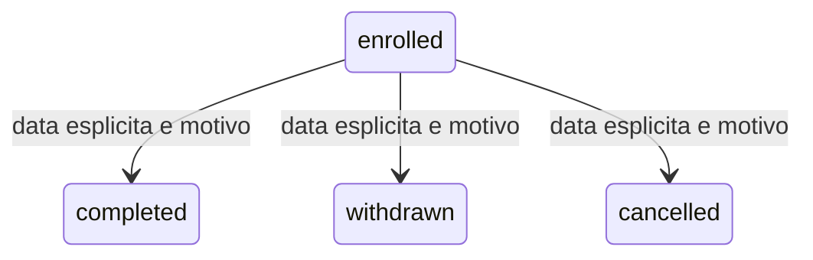

# Enrollment lifecycle e audit amministrativo MT-4C

MT-4C completata: due suite 675/675 Passed, zero Failed/Skipped; 644 identita precedenti preservate. Rollout chiuso. Esiti nel report MT4C. Questo checkpoint autorizza soltanto
`enrolled -> completed/withdrawn/cancelled` e la rettifica motivata di CompletionDate terminale.
Nessuna riattivazione, secondo episodio, correzione EnrollmentDate o trasferimento di risorse.
La UNIQUE tenant/Student/edizione e i trigger MT4A di immutabilita rimangono invariati.

## Stati e rettifiche autorizzate



Ciascuno stato terminale ammette esclusivamente una rettifica motivata della CompletionDate,
con nuova revision ed evento, senza uscire dallo stato. Nessun arco di ritorno o fra terminali.

## Registro e verita storica

`course_administration_event` e un registro istituzionale separato dall'AuditEvent Esami. Un evento
lifecycle svolge anche la funzione audit: non viene duplicato in un secondo registro. Eventi con
EnrollmentId costituiscono lo storico amministrativo di quella relazione; quelli del catalogo
registrano creazione/descrizione edizione, collegamento sede e prima attribuzione del gruppo.
Nessun EntityType Esami o platform fittizio. Le vecchie iscrizioni non ricevono eventi retroattivi;
l'assenza di eventi precedenti non prova l'assenza di modifiche storiche.

PK (InstitutionId,Id), con Id dell'intenzione generato dal client per transizioni/rettifiche e dal server
per le scritture MT4B. FK composite a Membership, CourseEdition, Enrollment, Campus, Class;
FK globale a User e FK (tenant,membership,actor) alla membership: impedisce anche successivi
trasferimenti dell'identita referenziata. L'indice univoco aggiuntivo serve tale FK, non e speculativo. SQL verifica che la membership appartenga all'attore e al tenant e abbia ruolo
InstitutionAdmin Active in una Institution Active al momento della scrittura. Revoche successive
non riscrivono l'attore storico. Cancellare identita/parent riferiti e protetto da RESTRICT.

Action tecnica e riferimenti tipizzati sostituiscono un EntityType/EntityId polimorfo senza FK.
CourseEditionId obbligatorio identifica il contesto; EnrollmentId/CampusId/ClassId sono valorizzati
solo quando appropriati. BeforeJson/AfterJson contengono snapshot minimi costruiti dal server,
mai password, JWT, connection string o l'intero payload HTTP. Eventi lifecycle hanno anche
PreviousStatus/NewStatus, date precedenti/nuove, RevisionBefore/After e Reason max1000.
OccurredAtUtc viene imposto da SQL UTC_TIMESTAMP(6), distinto dalla data amministrativa esplicita.

## Append-only e privilegi

Normali UPDATE e DELETE sono rifiutati da trigger SIGNAL, senza dipendere dai CHECK MySQL 5.7.
Nessuna route permette di editarli/cancellarli. Il registro non resiste a un DBA privilegiato capace di
cambiare schema/privilegi: least privilege, retention e backup restano requisiti di deployment.

Eccezione esplicita per il solo teardown dei dati sintetici: in electronic_register_test, una sessione
SQL root puo impostare @er_mt4c_purge_owner per un singolo tenant con codice MT4B_ seguito da
32 cifre esadecimali (fixture esistente), eliminare esclusivamente i suoi eventi e azzerare subito la
variabile. Nessun codice HTTP imposta tale variabile. Non vale per holding o fondazioni reali, ne
per un database diverso. Questa e manutenzione privilegiata di fixture, non una funzione API o
una deroga applicativa alla retention. I test append-only usano normali DML senza questo contesto.
In un deployment operativo questa eccezione resta inapplicabile per nome DB e codici; credenziali
applicative non devono avere privilegi DBA. Non si certifica hardening dei privilegi dell'ambiente XAMPP.

## Transazione e concorrenza

Enrollment.Revision BIGINT non negativo default0 e shadow property EF, concurrency token.
Backfill deterministico mediante default della nuova colonna, nessuna modifica alle colonne originali.
Ogni mutazione richiede ExpectedRevision e EventId non vuoto. Transazione dello stesso DbContext:
lock Enrollment WHERE InstitutionId/Id FOR UPDATE; lettura scoped; lookup dell'intenzione; confronto
revision; policy/data/motivo; UPDATE owner/id/revision con incremento1; INSERT evento; commit.
Eccezioni e cancellazione rilasciano la transazione con rollback; nessun commit separato dell'audit.

Il lock riguarda la sola iscrizione; nessun lock globale o tenant. Il lookup EventId non prende un gap
lock su un evento mancante. Due richieste della stessa relazione sono serializzate prima della prima
lettura consistente; un retry identico osserva l'evento del vincitore. Intento identico comprende
risorsa, azione, date/stato, motivo, ExpectedRevision e attore/membership. Stesso Id con contenuto
od attore differente: 409. La PK scoped risolve le gare dello stesso Id su relazioni diverse.

Un retry dopo risposta persa restituisce il risultato registrato, senza incremento/evento ulteriore,
anche se una rettifica successiva ha gia aumentato la revision: rileggere il dettaglio per lo stato
attuale. Nessun retry cieco dopo 409. Un nuovo intento usa nuova chiave e revision appena riletta.
Correzioni senza effettivo cambiamento data sono conflitti 409. Revision esaurita non viene azzerata.

## Policy e API

Date amministrative esplicite >= EnrollmentDate, anno persistibile >=1000. Nessun limite normativo
aggiunto, nessun uso dell'UTC server per inventare CompletionDate. Motivo non bianco obbligatorio.
Creazioni MT4B continuano ad accettare esplicitamente tutti i quattro stati tecnici, anche terminali
con data di fine non nota. La rettifica puo quindi aggiungere una CompletionDate nota a un record
terminale legacy con valore null; non inventa una precedente transizione.

InstitutionAdmin corrente puo modificare/leggere il registro del proprio tenant. Teacher e Student
non leggono motivi/attori e non mutano. /enrollments/me conserva la vista corrente, senza ragioni
interne; una history personale ridotta viene rinviata. JWT InstitutionAccess, membership/ruoli
rivalidati, Institution Active, policy InstitutionCourseAccess e CourseApi && SchoolApi invariati.
Header/body/query owner e Guid risorsa non autorizzano operazioni.

Quattro nuove route: POST /enrollments/{id}/transition, PUT /enrollments/{id}/completion-date,
GET /enrollments/{id}/history, GET /course-editions/{id}/audit, sotto /api/institution. Liste paginate
max100/default20; history Enrollment ordinata per revision/time/id, audit edizione per UTC/id.
Errori 400 input/data/motivo, 401 autenticazione, 403 ruolo/revoca/rollout, 404 fuori tenant/inesistente,
409 stato/revision/intento incoerente. Nessun endpoint globale audit o DELETE fisico.

## Database-first e limiti

004 EXPAND, 005 BACKFILL read-only, 006 VALIDATE in migrations/mt4; runner con database esatto,
loopback, inventario, preflight e backup leggibile/hash prima del DDL. Rerun di EXPAND su stato
completo/parziale rifiutato senza mutazioni; BACKFILL/VALIDATE ripetibili. Nessun DROP/reset o GLOBAL.
Scaffold candidato senza overwrite, una sola nuova entity copiata; Revision rimane shadow sulla
entity Enrollment precedente. Reconcile-Mt4c.py genera il sidecar e l'hook senza cambiare sidecar MT4A.
La navigazione EF Class del ledger e ignorata: la FK composite rimane SQL, evitando di alterare
la generazione degli owner shadow delle Class legacy. Letture usano proiezioni/scalari senza grafi.

Procedura riproducibile dalla root, con TEST_MYSQL_CONNECTION gia impostata esplicitamente sul
solo loopback electronic_register_test. Eseguire EXPAND soltanto su MT4A verificata senza MT4C:

```powershell
powershell -NoProfile -ExecutionPolicy Bypass -File migrations/mt4/Invoke-Mt4c.ps1 expand
powershell -NoProfile -ExecutionPolicy Bypass -File migrations/mt4/Invoke-Mt4c.ps1 backfill
powershell -NoProfile -ExecutionPolicy Bypass -File migrations/mt4/Invoke-Mt4c.ps1 validate
```

Il runner produce/verifica il backup prima del DDL; se EXPAND rileva uno stato esistente o parziale,
fermarsi e ispezionare, senza reset o retry cieco. Su DB gia migrato usare soltanto backfill/validate.
Per riprodurre il candidato e il mapping, dopo build della soluzione:

```powershell
$mt4cCandidate='migrations/mt4/candidate/mt4c-review-'+(Get-Date -Format 'yyyyMMddHHmmssffff')
powershell -NoProfile -ExecutionPolicy Bypass -File migrations/mt4/Scaffold-Mt4.ps1 -Candidate $mt4cCandidate
python migrations/mt4/Reconcile-Mt4c.py $mt4cCandidate
```

Il messaggio finale del vecchio scaffolder riguarda le tre entity MT4A: in MT4C non copiarle sopra
quelle esistenti. Usare il reconcile specifico, che copia soltanto la nuova entity ledger, genera
il sidecar e riconcilia l'hook. Se una nuova entity gia presente differisce dal candidato, il reconcile
rifiuta l'overwrite e richiede revisione. I candidati e i dump restano privati/ignorati da Git.

Writer tecnici MT4A conservati per fixture e compatibilita non sono nuovi workflow pubblici. Il metodo
SetEnrollmentStatusAsync non e usato dai manager istituzionali; segue il contatore ma non inventa
attori per manutenzioni legacy. La certificazione dell'audit riguarda le operazioni istituzionali descritte,
non qualunque modifica SQL privilegiata o una cronologia retroattiva completa.

Student.ClassId, ClassSubject, Exam, Grade, Submission, CourseEdition.Status e worker non sono
mutati dal lifecycle. Trasferimenti Class/Campus, unlink, riattivazioni, rettifiche stato/data iniziale,
episodi e onboarding rimangono fuori scope. Nessun MT5/cutover automatico.
